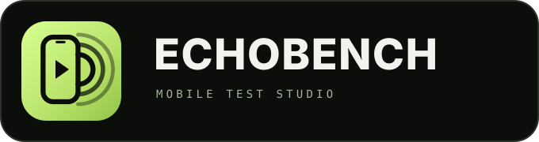
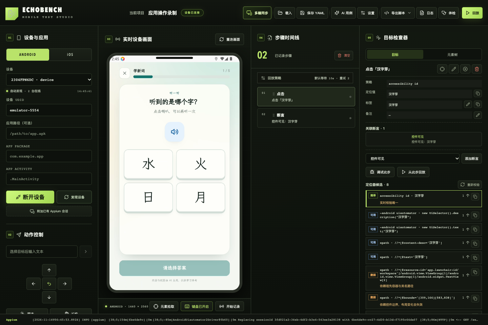
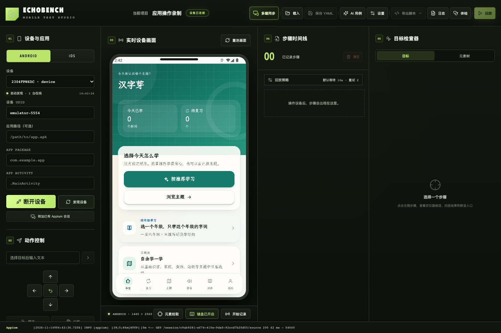
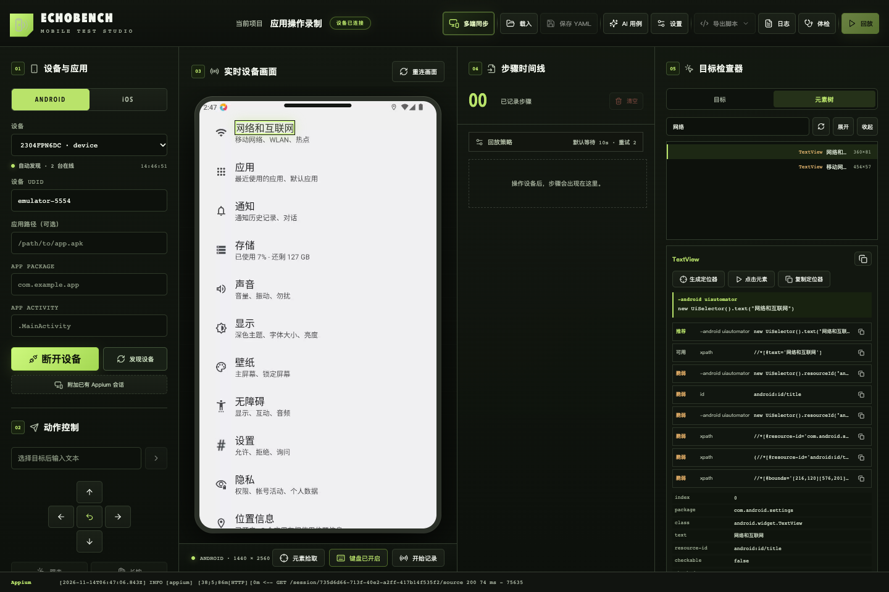
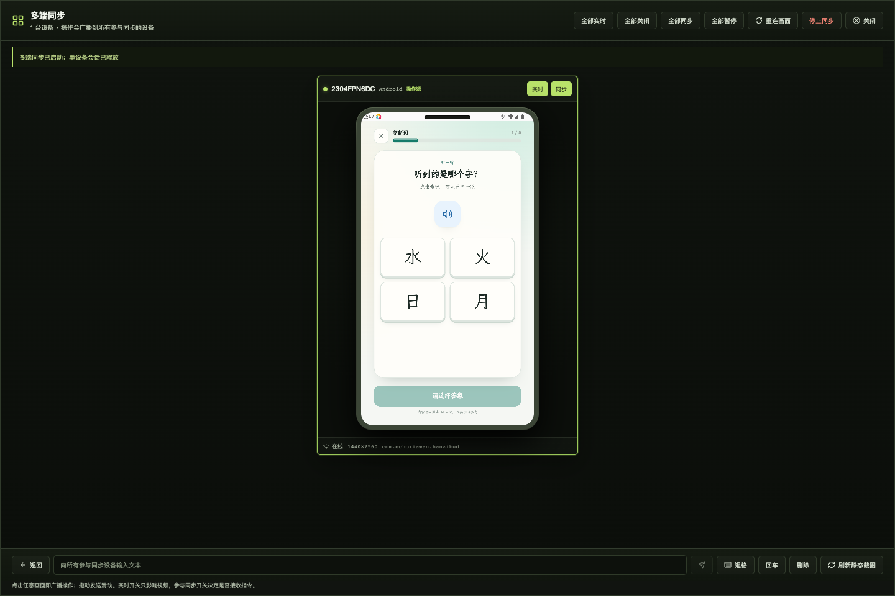
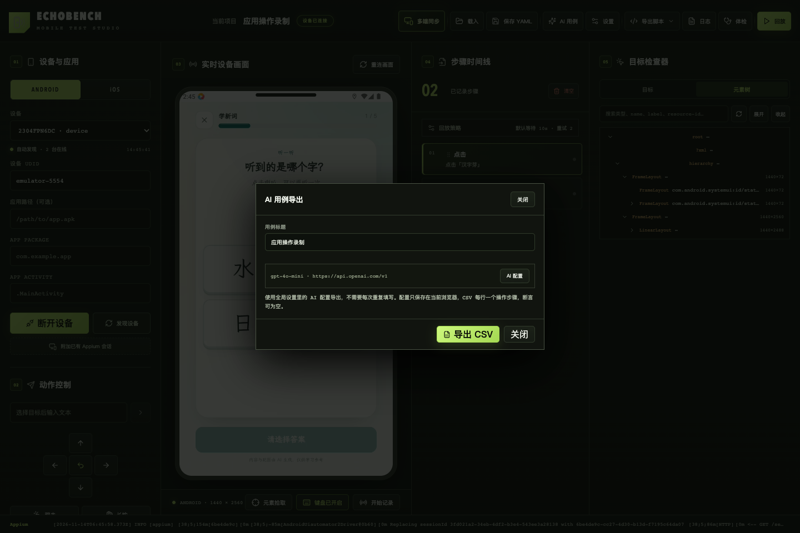
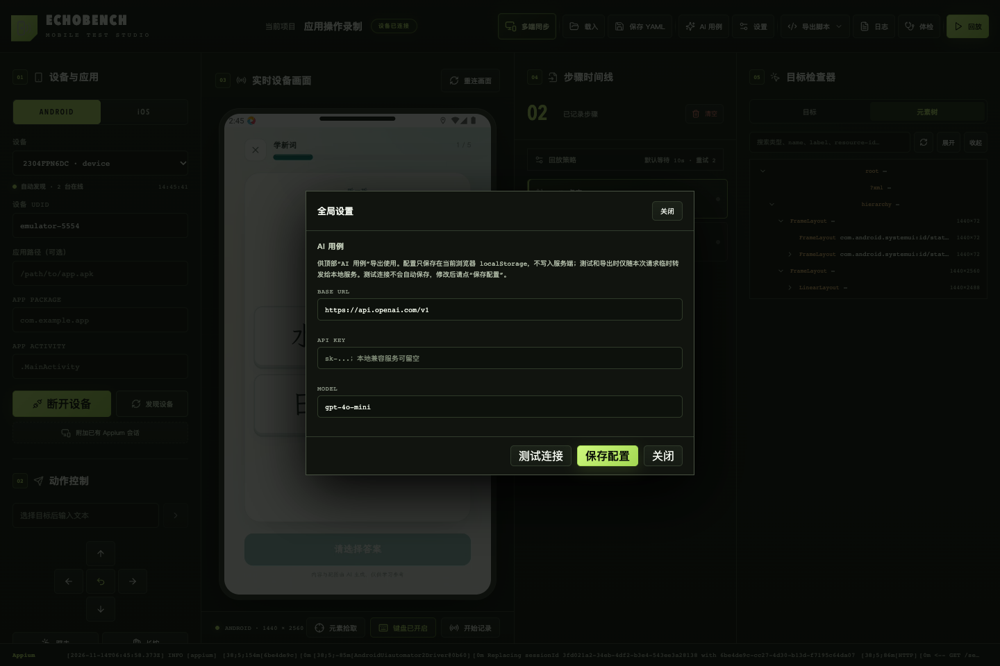
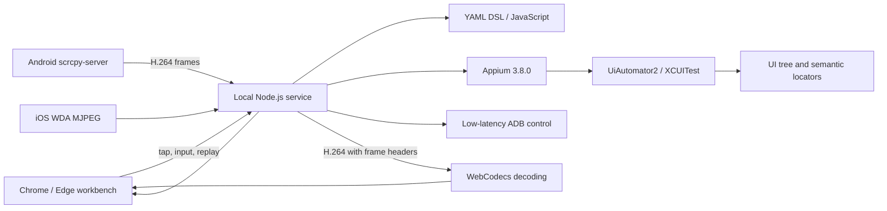

<div align="center">



# EchoBench

_Record. Replay. Echo._

Operate Android / iOS apps in your browser, record steps, validate locators in real time, run the same action across multiple devices, and replay.

[English](README.en.md) | [简体中文](README.md)


</div>

EchoBench is a **local-first** mobile test studio. You click on a device mirror in the browser; EchoBench sends the action to a physical device or emulator, identifies targets through the Appium UI tree, and records taps, input, swipes, and back actions as an editable, replayable YAML DSL. It also provides multi-device live views, **one-device operation with multi-device execution**, real-time locator validation, and AI-assisted CSV test-case export.

EchoBench can run from source in the browser or as an Electron desktop app. The desktop build reuses the same frontend and server, bundles Chromium, and checks GitHub Releases on every platform; when an update exists it shows the version, release notes, and a download URL for manual installation. Browser mode does not check for updates.

## Screenshots



<sub>Recording steps, assertions, and locator candidates. Captured from a local Android emulator; the sample pages are for demonstration only.</sub>

<table>
<tr>
<td width="50%"><br><sub><b>Connected device and live view</b></sub></td>
<td width="50%"><br><sub><b>Element tree and node-based locators</b></sub></td>
</tr>
<tr>
<td width="50%"><br><sub><b>Multi-device sync</b>: operate one, the others execute together</sub></td>
<td width="50%"><br><sub><b>AI test-case export</b></sub></td>
</tr>
<tr>
<td colspan="2" align="center"><br><sub><b>Global settings and AI configuration</b></sub></td>
</tr>
</table>

<sub>Workbench, element tree, multi-device sync, AI export, and global settings. Sample pages are for demonstration only.</sub>

## Why EchoBench

- **Local-first** — data, devices, logs, and AI settings stay on your machine. No account, cloud queue, or third-party device farm is required.
- **Explainable locators** — candidates, match counts, recommended/brittle roles, and replay fallback decisions are visible, not a black-box selector.
- **Multi-device sync** — operate one device and broadcast the action to every participating device; each device has independent live/sync switches and online state.
- **Attach without taking over** — connect to an existing Appium session; detaching does not end the external session by default.
- **Controllable AI** — AI is optional and works with any OpenAI-compatible endpoint, including local models.
- **Portable scripts** — YAML, WebdriverIO, Python, and Java can all run outside EchoBench.

It is a good fit for QA and developers who need local debugging, compatibility comparison, and a path from manual steps to scripts. It is not a large-scale cloud device matrix or an enterprise test-management suite. See [Comparison](docs/en/comparison.md).

## Comparison

| Category / representative | How EchoBench differs |
|---|---|
| Element inspection tools (Appium Inspector) | More than inspection: recording, replay, candidate validation, multi-device sync, and AI CSV |
| Open-source flow tools (Maestro) | Live device views, interactive recording, locator candidates with real-time validation, and multi-device sync |
| Visual / game testing (Airtest / Poco) | Focused on native UI trees and semantic locators; no visual recognition at this stage |
| Cloud device farms (BrowserStack / Sauce Labs / LambdaTest) | Data stays local, no per-minute cloud billing, convenient local debugging; no large-scale concurrency or cloud device coverage |
| Commercial suites (Katalon / TestComplete / Ranorex) | Local, lightweight, reviewable, no license fee; test management and enterprise governance are not yet covered |

[Full comparison and use cases](docs/en/comparison.md)

## Quick start

Prerequisites: Node.js `22.12+`, Chrome or Edge, Android SDK Platform-Tools, scrcpy `3.2`, and a JDK. iOS also requires macOS and a full Xcode installation.

```bash
npm ci
npm run build
npm start
```

Open `http://127.0.0.1:4710`, choose a device, and click **Connect**. Appium starts automatically on the first connection; you do not need a global Appium installation or a second Appium terminal.

The commands above are for **browser mode**. Desktop:

```bash
npm run desktop:dev          # development
./local-package.sh --dir     # unpacked app directory
./local-package.sh --dist    # installer for this OS; DMG on macOS
```

On macOS, drag `EchoBench.app` to Applications first; do not run it directly from the DMG. For the unsigned build, right-click → Open on first launch.

- Full installation (Windows / macOS / Linux): [Installation](docs/en/install.md)
- Connect a device, record your first flow, add assertions, and replay: [Quick start](docs/en/quickstart.md)
- From first launch to recording, assertions, replay, and export: [EchoBench user guide](docs/en/user-guide.md)
- Desktop installers and updates: [GitHub Releases](https://github.com/Echoxiawan/echobench/releases)
- The first physical iOS connection needs Xcode and WebDriverAgent signing; see the installation guide.

## Core capabilities

- **Recording and replay** — tap, input, swipe, back, double-tap, long-press, and pinch; supports single-step debugging and replay from any step.
- **Locator candidates and real-time validation** — each tap generates multiple candidates and uses Appium `/elements` to confirm uniqueness and element bounds; safe candidates are used when the primary locator fails.
- **Assertions** — exists, visible/hidden, enabled/disabled, checked/unchecked, text match, empty, and page stable; assertions are editable `wait` steps.
- **Gestures and keyboard** — drag directly on the device mirror; keyboard input is enabled by default, supports Chinese input methods, and merges continuous typing into one step.
- **Multi-device sync** — operate any one device and have every participating Android/iOS device execute the same tap, swipe, input, or back action; live/sync switches are independent. Operation only, no recording.
- **Attach session and element tree** — take over an existing Appium session; expand the native hierarchy, search attributes, highlight elements, and generate locators from a node.
- **Multi-language export** — runnable WebdriverIO JavaScript, Appium Python Client, and Appium Java Client scripts.
- **AI test-case export** — configure an OpenAI-compatible endpoint globally, enter the test-case title manually, and export one operation plus optional assertion per CSV row.
- **Environment checks** — check Node, Appium drivers, adb, scrcpy, JDK, Android SDK, and Xcode by OS; missing system tools have install actions.
- **Draft and workbench** — steps, project name, device config, and replay settings are cached locally; drafts restore, steps can be reordered, labeled, and annotated.

## Platform support

| Host OS | Android physical | Android emulator | iOS physical | iOS simulator |
| --- | ---: | ---: | ---: | ---: |
| Windows 10/11 x64 | Supported | Supported | Not supported | Not supported |
| macOS | Supported | Supported | Supported | Supported |
| Linux x64 | Supported (not fully validated on a device matrix) | Supported (not fully validated on a device matrix) | Not supported | Not supported |

iOS automation depends on Xcode, XCUITest, and the iOS Simulator, so it runs only on macOS. Windows and Linux disable the iOS entry point and hide the Xcode / XCUITest checks.

## How it works



Android video does not use Appium screenshot polling and does not require FFmpeg. scrcpy-server sends H.264 with frame boundaries and PTS through ADB reverse to Node.js; the browser decodes it directly with WebCodecs and drops stale non-key frames when decoding falls behind. See [Architecture](docs/en/architecture.md).

## Documentation

| Document | Contents |
| --- | --- |
| [Documentation index](docs/en/README.md) | Entry point for all English docs |
| [EchoBench user guide](docs/en/user-guide.md) | Beginner-oriented environment checks, recording, assertions, replay, export, and troubleshooting |
| [Installation](docs/en/install.md) | Windows / macOS / Linux, Android SDK, scrcpy, JDK, Xcode, ports |
| [Quick start](docs/en/quickstart.md) | Connect a device, record, assert, replay, draft, and stop |
| [YAML format](docs/en/yaml.md) | Actions, assertions, replay policy, candidate structure |
| [Script export](docs/en/export.md) | WebdriverIO, Python, and Java runners |
| [Multi-device sync](docs/en/multi-device.md) | One-device operation, multi-device execution, and platform risks |
| [Attach session and element tree](docs/en/inspect-session.md) | Session ID, attach mode, element tree, and node-based locators |
| [AI test-case export](docs/en/ai-export.md) | OpenAI-compatible configuration, CSV structure, and assertion rules |
| [Logs and cleanup](docs/en/operations.md) | Log rotation, environment variables, shutdown, and residual processes |
| [Performance](docs/en/performance.md) | Android/iOS video, iOS latency optimizations, and multi-device overhead |
| [Troubleshooting](docs/en/troubleshooting.md) | Device connection, iOS signing, black screens, locator risk, and session failures |
| [Security and limitations](docs/en/limitations.md) | Local-service risks, plaintext input, boundaries, and platform limits |
| [Architecture](docs/en/architecture.md) | Data flow, source layout, verified environment, and tradeoffs |
| [Comparison](docs/en/comparison.md) | Differences from inspection, flow, cloud-farm, and code-framework tools |
| [Desktop app and online updates](docs/en/desktop.md) | Electron shell, unsigned packaging, GitHub Releases, and update policy |

## Security and privacy

- The service listens only on `127.0.0.1:4710` and has no login. Do not reverse-proxy it or expose it to the public internet.
- Appium also has no authentication by default; a server URL plus Session ID is equivalent to device control.
- YAML, the UI, and exported scripts store input values in plaintext. Do not record real passwords, tokens, or personal sensitive data. `secret: true` does not hide or encrypt values.
- Drafts and AI settings live in the current browser's localStorage; AI requests pass through the local service only temporarily.
- Logs may contain page source and device information. Redact them before filing an issue.

For vulnerability disclosure, see [SECURITY.md](SECURITY.md). For full limitations, see [Security and limitations](docs/en/limitations.md).

## Contributing

Issues, documentation improvements, and pull requests are welcome. Please read:

- [Contributing guide](CONTRIBUTING.en.md) — development, testing, and submission conventions;
- [CLA](CLA.md) — first-time contributors sign it in a PR comment; checking the PR checkbox alone is not a signature;
- [Corporate CLA](CCLA.md) — for contributions made as part of employment;
- [Code of Conduct](CODE_OF_CONDUCT.md).

CI runs `npm run typecheck`, `npm test`, and `npm run desktop:build`. Run the same three commands locally before submitting.

## Contact

<table>
<tr>
<td align="center" width="33%">
<br>
<b>Author's WeChat</b><br>
<sub>Please mention EchoBench when adding</sub>
</td>
<td align="center" width="33%">
<br>
<b>WeChat Official Account</b><br>
<sub>Follow for project updates and articles</sub>
</td>
<td align="center" width="33%">
<a href="https://x.com/AiYouyisi"></a><br>
<b>X (Twitter)</b><br>
<sub>Follow for project news</sub>
</td>
</tr>
</table>

<sub>The QR codes are for project communication. Please read [Troubleshooting](docs/en/troubleshooting.md) before filing an issue.</sub>

## License

EchoBench is licensed under the [Apache License 2.0](LICENSE), which permits personal and commercial use, modification, and distribution. Redistributions must retain the copyright notice, the license text, and [NOTICE](NOTICE), and must indicate changes.

Apache-2.0 permits commercial use. Third-party dependencies remain subject to their own licenses.

## Acknowledgements

EchoBench builds on Appium, UiAutomator2, XCUITest, scrcpy, React, Vite, and lucide-react. Thanks to their maintainers and all contributors.
