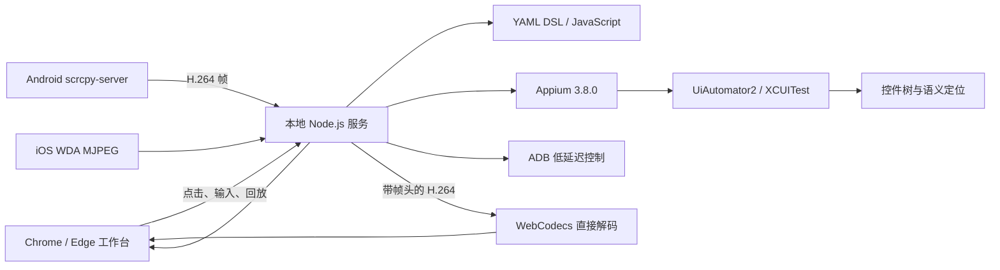

# 工作原理与代码结构

## 数据流



Android 视频不经过 Appium 截图轮询，也不依赖 FFmpeg。scrcpy-server 通过 ADB reverse 将带帧边界和 PTS 的 H.264 发给 Node.js，浏览器通过 WebCodecs 直接解码；解码积压时优先丢弃过期的非关键帧，保持操作画面的实时性。

## 代码结构

```text
echobench/
├── electron/              # 历史目录名；Appium 客户端、定位器、回放和导出
│   ├── appium-client.ts   # Appium 客户端、手势和控件树缓存
│   ├── locator.ts         # 候选定位器生成、计数、排序与安全降级
│   ├── replay.ts          # 回放引擎：等待、重试、断言和候选降级
│   ├── script.ts          # YAML 校验、序列化和 JavaScript 导出
│   ├── export-model.ts    # 三种导出共享的步骤模型与选择器映射
│   ├── export-python.ts   # Appium Python Client 导出
│   └── export-java.ts     # Appium Java Client 导出
├── server/
│   ├── index.ts           # HTTP/SSE、设备发现、ADB 控制、进程生命周期
│   ├── devices.ts         # adb / xctrace 设备状态解析
│   ├── doctor.ts          # 环境体检
│   ├── system.ts          # 操作系统能力与包管理器识别
│   ├── setup.ts           # 依赖安装计划与执行
│   ├── ai.ts              # AI 用例生成、连通性检测与 CSV
│   ├── multi.ts           # 多端会话、状态、同步广播与多设备视频
│   ├── inspector.ts       # page source 元素树扁平化
│   ├── logger.ts          # 持久化运行日志与 SSE 推送
│   └── video-stream.ts    # 按设备管理的 scrcpy H.264 / WDA MJPEG
├── src/
│   ├── App.tsx            # 录制工作台、多端同步工作区和视频解码
│   ├── ai-config.ts       # 浏览器本地 AI 配置
│   ├── setup-plan.ts      # 启动自动安装策略
│   ├── draft.ts           # 最近一次录制草稿的本地缓存与校验
│   ├── layout.ts          # 步骤/检查器列宽记忆与窄屏压缩
│   ├── studio-api.ts      # 浏览器端 API/SSE 封装
│   ├── styles.css         # 页面样式
│   └── types.ts           # 前后端共享类型
├── test/                  # node:test 用例
├── docs/                  # 使用、运维和设计文档
├── examples/              # 可载入的 YAML 示例
├── package.json
├── package-lock.json
└── vite.config.ts
```

`electron/` 只是早期代码迁移后保留的目录名，里面是 Appium 客户端、定位器、回放和导出等共享核心代码，不是 Electron 主进程。Electron 桌面壳位于 `desktop/`，只在桌面构建时使用；当前仍保留浏览器运行方式。

## 验证环境

| 项目 | 已验证环境 |
| --- | --- |
| 操作系统 | macOS；Windows/Linux 的 Android 路径按系统能力检查实现 |
| Node.js | `22.12+` |
| Appium | `3.8.0` |
| UiAutomator2 | `8.7.0` |
| XCUITest | `12.18.1` |
| Android | Android 12 模拟器：设备发现、Appium 会话、实时视频、点击录制和回放 |
| iOS | iPhone 真机：会话、视频、截图和多端同步；首次使用仍需 Xcode/WDA 签名配置 |

具体版本会随依赖升级变化；如果升级 Appium、XCUITest 或 Xcode 后出现异常，先回到本表对应的固定版本排查。

## 开发模式

```bash
npm run dev
```

- 前端开发地址：`http://127.0.0.1:5173`；
- 本地 API：`http://127.0.0.1:4710`；
- Appium：第一次连接时自动启动在 `http://127.0.0.1:4723`。

提交前执行：

```bash
npm run typecheck
npm test
npm run build
```

生产服务必须先执行 `npm run build`，因为 `npm start` 直接运行已编译的 `dist-server` 和 `dist`，不会自动重新编译源码。

## 设计取舍

- **本地优先**：服务只监听 `127.0.0.1`，不依赖云端队列或第三方设备农场。
- **可解释定位**：候选、命中数、推荐/脆弱和回放降级过程都展示出来。
- **安全降级**：主定位失效时只使用唯一安全候选或唯一序号候选，不会盲点第一个元素。
- **录制与拾取一致**：两条路径共用“最新 page source + 候选定位器”解析流程。
- **AI 可选**：AI 只整理步骤和断言，不执行设备操作；配置由用户自己的模型提供。

性能细节见 [性能与硬件占用](performance.md)。
