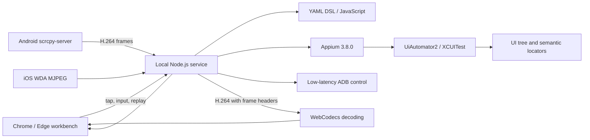

# Architecture

## Data flow



Android video does not use Appium screenshot polling and does not require FFmpeg. scrcpy-server sends H.264 with frame boundaries and PTS through ADB reverse to Node.js; the browser decodes it directly with WebCodecs and drops stale non-key frames when decoding falls behind, keeping the operation view real-time.

## Source layout

```text
echobench/
├── electron/              # Legacy directory name; Appium client, locators, replay, export
│   ├── appium-client.ts   # Appium client, gestures, UI-tree cache
│   ├── locator.ts         # Candidate generation, counting, ranking, safe fallback
│   ├── replay.ts          # Replay engine: waits, retries, assertions, fallback
│   ├── script.ts          # YAML validation, serialization, JavaScript export
│   ├── export-model.ts    # Shared step model and selector mapping
│   ├── export-python.ts   # Appium Python Client export
│   └── export-java.ts     # Appium Java Client export
├── server/
│   ├── index.ts           # HTTP/SSE, device discovery, ADB control, lifecycle
│   ├── devices.ts         # adb / xctrace device parsing
│   ├── doctor.ts          # Environment checks
│   ├── system.ts          # OS capabilities and package managers
│   ├── setup.ts           # Install planning and execution
│   ├── ai.ts              # AI case generation, connectivity, CSV
│   ├── multi.ts           # Multi-device sessions, status, broadcast, video
│   ├── inspector.ts       # page source element-tree flattening
│   ├── logger.ts          # Persistent logs and SSE
│   └── video-stream.ts    # Per-device scrcpy H.264 / WDA MJPEG
├── src/
│   ├── App.tsx            # Recording workbench, multi-device workspace, video decoding
│   ├── ai-config.ts       # Browser-local AI settings
│   ├── setup-plan.ts      # Startup install policy
│   ├── draft.ts           # Draft cache and validation
│   ├── layout.ts          # Column-width memory and narrow-screen compression
│   ├── studio-api.ts      # Browser API/SSE client
│   ├── styles.css         # Styles
│   └── types.ts           # Shared types
├── test/                  # node:test suites
├── docs/                  # Usage, operations, and design docs
├── examples/              # Loadable YAML examples
├── package.json
├── package-lock.json
└── vite.config.ts
```

`electron/` is a legacy directory name; it contains shared core code such as the Appium client, locators, replay, and export. It is not the Electron main process. The desktop shell lives in `desktop/` and is used only for desktop builds; the browser workflow remains available.

## Development mode

```bash
npm run dev
```

- Frontend: `http://127.0.0.1:5173`;
- Local API: `http://127.0.0.1:4710`;
- Appium: starts automatically at `http://127.0.0.1:4723` on the first connection.

Before submitting:

```bash
npm run typecheck
npm test
npm run build
```

`npm start` runs the compiled `dist-server` and `dist`, so run `npm run build` first after source changes.

## Verified environment

| Item | Verified environment |
| --- | --- |
| OS | macOS; Windows/Linux Android paths are implemented and checked by OS capabilities |
| Node.js | `22.12+` |
| Appium | `3.8.0` |
| UiAutomator2 | `8.7.0` |
| XCUITest | `12.18.1` |
| Android | Android 12 emulator: discovery, Appium session, live video, tap recording, replay |
| iOS | Physical iPhone: session, video, screenshots, and multi-device sync; first use still needs Xcode/WDA signing |

Versions change with dependency upgrades. If upgrading Appium, XCUITest, or Xcode causes problems, return to the pinned versions in this table first.

## Design tradeoffs

- **Local-first**: the service listens only on `127.0.0.1` and does not depend on a cloud queue or third-party device farm.
- **Explainable locators**: candidates, match counts, recommended/brittle roles, and fallback decisions are visible.
- **Safe fallback**: when the primary locator fails, only unique safe candidates or a unique indexed candidate are used; EchoBench never blindly taps the first match.
- **Recording/picking parity**: both paths share the same "latest page source + locator candidates" pipeline.
- **Optional AI**: AI only organizes steps and assertions. It never operates devices, and users supply their own model endpoint.

See [Performance](performance.md) for tuning details.
