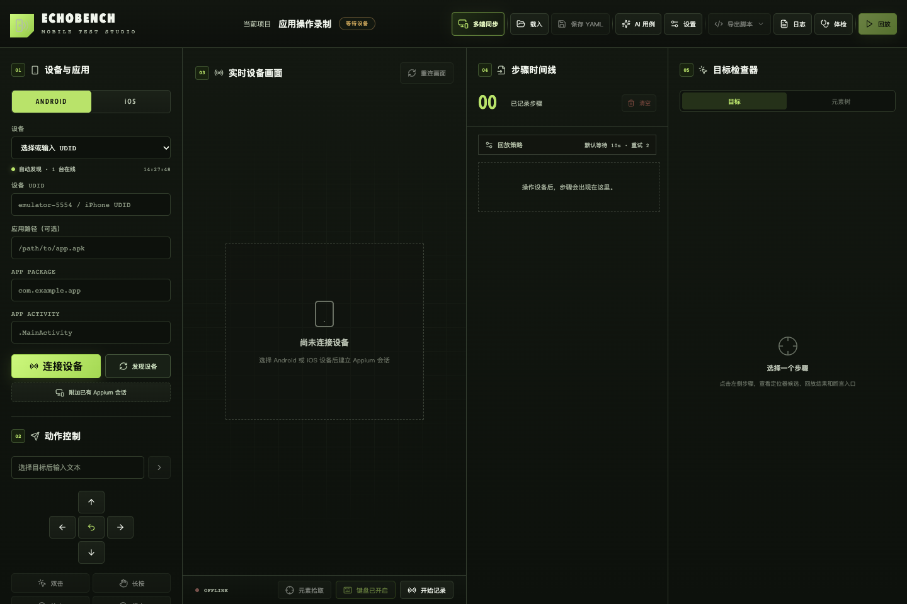
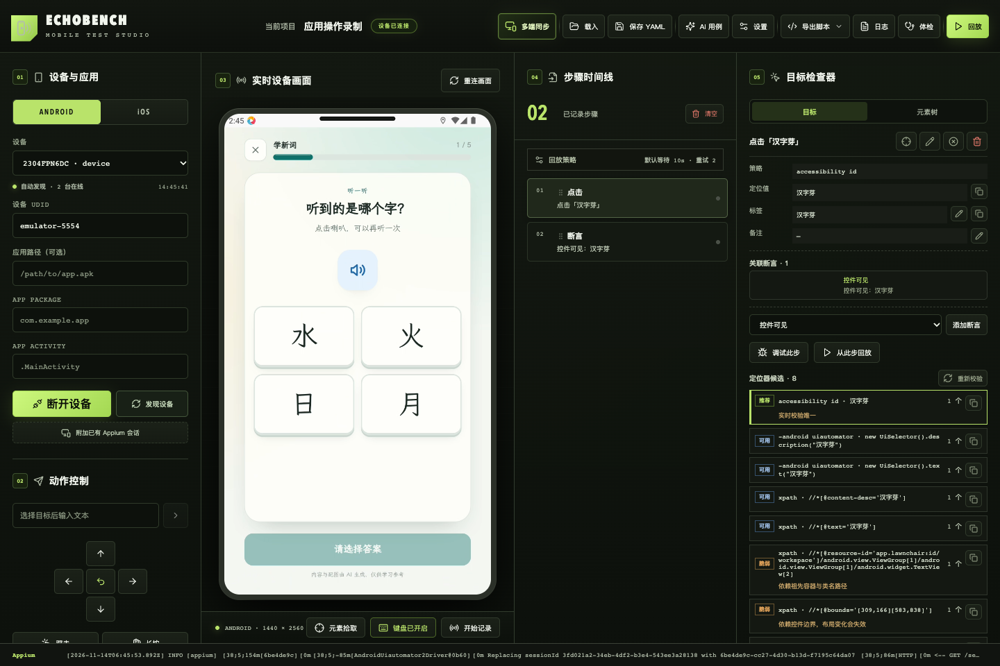
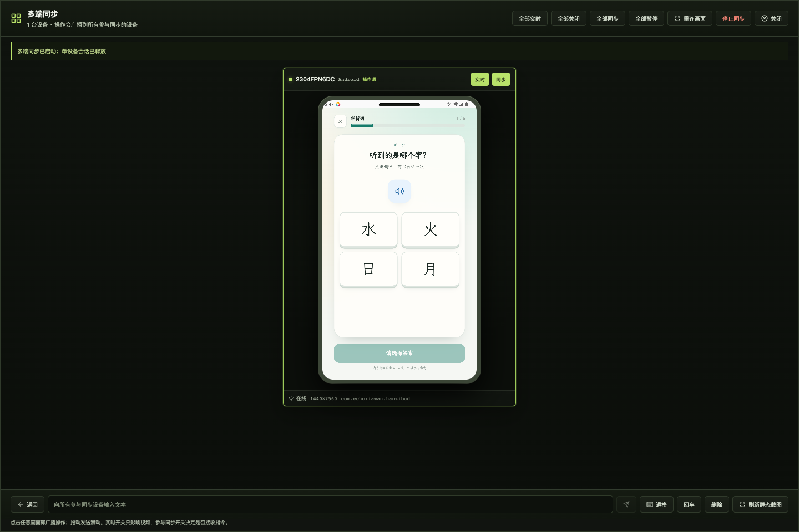
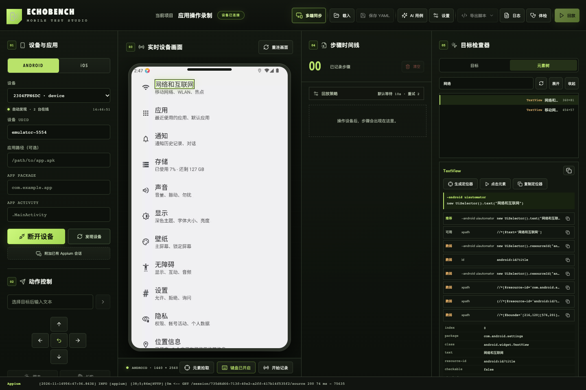
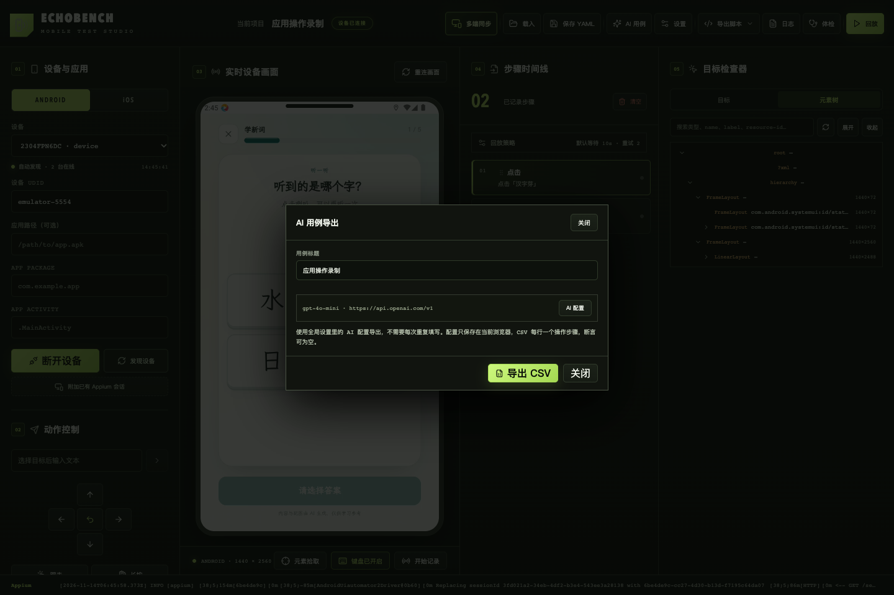

# EchoBench User Guide

[English](user-guide.md) | [简体中文](../user-guide.md)

> Applies to: EchoBench 1.0.0
>
> Audience: first-time testers, product team members, and developers
>
> Scope: how to use the finished product, including the first-launch environment check and dependency installation. It does not cover installing or deploying EchoBench itself, building from source, or command-line setup.

EchoBench is a local-first mobile test workbench. Think of it as three tools in one:

1. **A device remote control**: see the phone in your browser and tap, type, and swipe on it.
2. **An action recorder**: turn your device actions into an editable list of steps.
3. **An automatic replayer**: make the device execute those steps again and verify the expected result.

This guide starts after the product has been opened. Follow it once from beginning to end, and you will connect a device, record a flow, add an assertion, replay it, save YAML, and export CSV or code.

---

## Contents

- [Before you start](#before-you-start)
- [Tour the main screen](#tour-the-main-screen)
- [First launch: check the environment and install dependencies](#first-launch-check-the-environment-and-install-dependencies)
- [First run: complete a flow in 10 minutes](#first-run-complete-a-flow-in-10-minutes)
- [Common actions](#common-actions)
- [Understand locators and locator risk](#understand-locators-and-locator-risk)
- [Add assertions](#add-assertions)
- [Replay and debug](#replay-and-debug)
- [Save, load, and export](#save-load-and-export)
- [Multi-device sync](#multi-device-sync)
- [Element tree and attaching an existing session](#element-tree-and-attaching-an-existing-session)
- [AI test-case export](#ai-test-case-export)
- [Drafts, deletion, and clearing](#drafts-deletion-and-clearing)
- [Logs and environment checks](#logs-and-environment-checks)
- [Security](#security)
- [Troubleshooting](#troubleshooting)
- [Beginner checklist](#beginner-checklist)
- [Glossary](#glossary)

---

## Before you start

### 1. Recording off does not mean read-only

When recording is off, tapping the device view still operates the phone. EchoBench simply does not add the action to the timeline.

If you want to inspect a control without operating the device, turn on **Element pick**. A tap then only reads locator information.

### 2. Walk through the flow manually first

Before recording, confirm that:

- the app opens normally;
- the page has finished loading;
- the buttons and input fields you need are visible;
- the test account and test data are ready.

Return to the starting page before recording.

### 3. Always replay after recording

Steps appearing in the timeline do not guarantee that the flow is stable. The correct process is:

1. stop recording;
2. restore the device to the page before the first step;
3. click **Replay** in the toolbar;
4. confirm every step passes;
5. save YAML or export another format.

---

## Tour the main screen



The main screen contains a toolbar and five work areas. You do not need to memorize every button at first.

### Toolbar

| Location | Button | Purpose |
| --- | --- | --- |
| Left | EchoBench logo | Product identity |
| Center | Current project and device state | Shows the project name; green "Device connected" means the session is healthy |
| Right | **Multi-device sync** | Open the multi-device workspace |
| Right | **Load** | Select and load an existing YAML script |
| Right | **Save YAML** | Download the current steps as `app-steps.yaml` |
| Right | **AI test case** | Use AI to turn steps into a CSV test case |
| Right | **Settings** | Configure the AI endpoint, key, and model |
| Right | **Export script** | Export WebdriverIO JavaScript, Python, or Java |
| Right | **Logs** | Inspect recent runtime logs and errors |
| Right | **Environment** | Check the local runtime environment |
| Far right | **Replay** | Execute the current timeline from the first step |

A grayed-out button usually means a prerequisite is missing:

- Replay is disabled without a connected device;
- Save YAML is disabled without steps;
- iOS is disabled when the current operating system does not support iOS automation.

### The five work areas

| Area | Name | What you can do |
| --- | --- | --- |
| 01 | **Device and app** | Choose Android/iOS, select a device, connect it, or attach an existing session |
| 02 | **Action controls** | Enter text, swipe in a direction, go back, double-tap, long-press, pinch, and pick elements |
| 03 | **Live device view** | See the device, tap, drag, and type; the bottom controls recording and keyboard input |
| 04 | **Step timeline** | Review steps, reorder them, configure replay policy, and inspect results |
| 05 | **Target inspector** | Review locator candidates, edit labels and notes, add assertions, debug a step, and browse the element tree |

Drag the vertical separator between areas to resize them. Double-click the separator to restore the default width.

### The three controls below the device view

- **Element pick**: tap the view to read element information without operating the phone.
- **Keyboard input**: type into the device with your computer keyboard.
- **Start recording / Stop recording**: control whether actions are added to the timeline.

---

## First launch: check the environment and install dependencies

Opening the app does not automatically mean the device environment is ready. On first launch, run the environment check before connecting a device.

### Automatic check

About 0.6 seconds after the page opens, EchoBench checks the environment automatically. A device is not required.

If a required item is missing, the **Environment check** dialog opens automatically. If it does not, click **Environment** in the toolbar.

### Read the results

The check covers:

- the Node.js version;
- Appium and UiAutomator2;
- XCUITest on macOS;
- Android SDK, `adb`, `scrcpy`, and the matching `scrcpy-server`;
- JDK / `JAVA_HOME`;
- Xcode command-line tools and simulator availability on macOS.

The result states mean:

- **OK**: no action is needed;
- **Required** and failing: fix it before connecting a device or replaying;
- **Installable**: the dialog can install it for you;
- **Warning**: read the detail and decide whether it affects your target platform.

Windows does not show Xcode/XCUITest checks. Linux keeps Android checks only. These are platform limits, not installation failures.

### Install missing dependencies

1. Find the item that is not OK and has an **Install** button.
2. For a single item, click **Install** next to it.
3. For multiple items, click **Install missing items**.
4. Wait for the result and do not close the app or click repeatedly.
5. The dialog refreshes the check results automatically after installation.
6. If the app asks you to restart, close and reopen EchoBench.
7. If an item still fails, click **Recheck**.

Installation behavior by platform:

| System | Behavior |
| --- | --- |
| macOS | Uses Homebrew |
| Windows | Uses winget |
| Linux | Shows the matching `sudo` command; it does not elevate privileges silently |

Project-local Appium drivers are installed automatically at startup. You do not need to install them manually.

### If the environment still fails

- click **Logs** in the toolbar for the actual error;
- restart EchoBench after installing a package manager or a system tool so the new `PATH` is loaded;
- click **Recheck** to refresh the result;
- see [Installation](install.md) for the complete manual setup and troubleshooting details.

### Before you continue

- [ ] All required items for your platform pass;
- [ ] Android has working `adb`, `scrcpy`, and JDK checks;
- [ ] iOS has working Xcode and XCUITest checks;
- [ ] No "restart required" message remains;
- [ ] Rechecking does not bring the same missing item back.

Only continue to the recording flow after these checks pass.

---

## First run: complete a flow in 10 minutes

The example below logs in and reaches the home page. Button names in your app will differ, but the sequence is the same.

### Step 1: Select a device

1. In **Device and app**, select **ANDROID** or **iOS**.
2. Choose a device from the **Device** list.
3. If the list is empty, click **Discover devices**.
4. Only devices with the `device` state can be connected. An `offline`, `unauthorized`, or "not running" device needs attention first.

The **Device UDID** field is filled automatically. You can also enter the device identifier manually.

### Step 2: Fill in app information

For the first run, keep this simple:

- If the app is already open on the phone, leave **App path**, **APP PACKAGE**, **APP ACTIVITY**, and **BUNDLE ID** empty.
- Fill in a package, Activity, or Bundle ID only when EchoBench should launch a specific app.
- Fill in **App path** only when EchoBench should launch an app from a local package.

> Beginner tip: open the app manually, connect the device, and leave the app fields empty.

### Step 3: Connect the device

1. Click **Connect**.
2. Wait for the live phone view to appear.
3. A status such as `ANDROID - 1080 x 2400` at the bottom means the connection is ready.

The first connection is usually slower because EchoBench starts the underlying automation service.

If the view does not appear:

- make sure the phone is unlocked;
- make sure the device is still online;
- click **Reconnect view** above the device;
- open **Logs** in the toolbar.

### Step 4: Try the flow manually without recording

The bottom control should read **Start recording**, which means recording is off.

Manually complete the login flow:

1. tap the username field;
2. type the test account with the computer keyboard;
3. tap the password field;
4. type the test password;
5. tap the login button;
6. confirm that the home page opens.

This pass is only a readiness check and does not create steps.

### Step 5: Return to the starting page and record

1. Navigate back to the login page.
2. Click **Start recording**. The button changes to **Stop recording**.
3. Repeat the same flow.
4. Each tap, input, swipe, or back action appears in the **Step timeline**.
5. After typing stops for about 0.3 seconds, the input is merged into one input step.



### Step 6: Add a result assertion

For "the home page appears after login":

1. After login succeeds, leave the device on the home page.
2. Click **Element pick** at the bottom, then tap a clear home-page element such as the page title.
3. In the **Target inspector**, choose **Control visible**.
4. Click **Add assertion**.
5. A step such as "Assertion: Control visible: ..." appears in the timeline.
6. Click **Element pick** again to leave pick mode.

Do not select the "Tap login" step and add a "home page" assertion there. That step targets the login button, not a home-page control. See [Add assertions](#add-assertions) for details.

### Step 7: Stop recording and replay

1. Click **Stop recording**.
2. Restore the device to the login page.
3. Click **Replay** in the toolbar.
4. Confirm that every step passes.
5. If a step fails, read the **Failure reason** in the target inspector first.

### Step 8: Save the result

- Click **Save YAML** to download `app-steps.yaml`.
- Use **AI test case** when you need a CSV for a test-management tool.
- Use **Export script** when the flow must continue in an automation project.

The flow is now recorded and replayable.

---

## Common actions

### Tap

1. Click **Start recording** at the bottom.
2. Tap the target in the live device view.
3. The device performs the tap and the timeline receives a tap step.
4. The target inspector shows the locator and candidates used for that tap.

If no step appears:

- confirm that recording is still on;
- confirm that replay or another task is not running;
- check whether **Element pick** is on. Pick mode does not send taps.

### Type text

Use **Keyboard input** at the bottom:

1. Confirm that the control reads **Keyboard on**.
2. Tap the input field on the device so it receives focus.
3. Type with the computer keyboard. Chinese input methods are supported.
4. After about 0.3 seconds, when you tap elsewhere, or when you perform the next action, EchoBench creates an input step.

Important behavior:

- the device input field must have focus; otherwise a notice says that no input field is focused;
- continuous input into the same field normally remains one input step;
- moving to another field creates a new input step;
- input values are stored in plaintext in YAML and exported files. Do not record real passwords, tokens, or personal data.

The "type after selecting a target" field in **Action controls** is an alternative for a selected step with a locator. Beginners should use normal keyboard input.

### Swipe

You can swipe in two ways:

**Drag directly on the device view**

1. Press and drag on the device view.
2. EchoBench uses the actual start point, end point, and drag duration.
3. When recording is on, the timeline receives a swipe step with the actual path.

**Use the arrow controls**

- the up, down, left, and right arrows perform the default swipe in that direction;
- the curved arrow in the center performs Back;
- when recording is on, arrow swipes save the default start/end coordinates and distance.

### Back

Click the center Back control in the arrow pad. When recording is on, EchoBench adds a "Back one page" step.

### Double-tap, long-press, pinch out, and pinch in

These actions need a selected timeline step:

1. Select a step whose target is the control you need.
2. Click **Double tap**, **Long press**, **Pinch out**, or **Pinch in** in **Action controls**.
3. When recording is on, the new action is appended to the timeline.

- Double-tap and long-press use the selected step's target.
- Pinch uses the selected target when available; otherwise it uses the center of the screen.
- Long-press lasts 800 ms by default.
- Pinch lasts 600 ms by default.

### Element pick

Use Element pick when you want to inspect a control without operating the device.

1. Click **Element pick** at the bottom.
2. Tap the target on the device view.
3. EchoBench reads the control and locator without tapping the phone.
4. The result appears in the target inspector.
5. You can:
   - edit the label;
   - add the result as a tap step;
   - add an assertion;
   - review and switch locator candidates;
   - revalidate the locator.

If the result says "coordinates only", the location has no usable native-control information. You can edit the label and add a coordinate tap, or consider a **Page stable** assertion.

### Reorder and edit steps

- drag a timeline step to change its order;
- select a step and use the trash button in the target inspector to delete it;
- edit the step label, note, and input value;
- the inspector also shows associated assertions, locator candidates, and replay results.

### Refresh the UI tree

If the page has changed but EchoBench still sees controls from the old page:

1. click **Refresh UI tree** under **Action controls**;
2. wait for the tree to load;
3. tap again or use Element pick.

On iOS, try this first when locators are inaccurate after a page transition.

---

## Understand locators and locator risk

### What is a locator

A locator is the address EchoBench uses to find a control.

Instead of remembering only "a button near the bottom center of the screen", EchoBench can remember:

- the button text;
- the resource ID;
- the accessibility name;
- the control's position in the UI hierarchy.

This gives replay a better chance of finding the same control after small layout changes.

### The three candidate types

After you select a step, the **Locator candidates** section shows several options:

| Badge | Meaning | Recommendation |
| --- | --- | --- |
| **Recommended** | Matches one element, uses a stable strategy, and was verified against the bounds | Use first |
| **Alternative** | Matches one element and can be used as a backup | Switch to it when the recommended locator fails |
| **Brittle** | Depends on an index, coordinate range, or weak hierarchy | Avoid as the primary locator |

A value next to the candidate shows the match count. "1" means one element matched.

### What "Locator risk" means

**Locator risk** means that, during recording, EchoBench could not find a reliable locator.

Common causes:

- the page was still changing when you tapped;
- the tap landed on a background image, full-screen container, or custom-drawn area;
- the icon has no text, resource ID, or accessibility information;
- several controls on the page look identical.

Handle it in this order:

1. wait for the page to settle and record the tap again;
2. select the step and click **Revalidate** in the inspector;
3. switch to a Recommended or Alternative candidate;
4. use **Element pick** if needed;
5. if the control has no semantic information, use a coordinate tap. Do not enable coordinate fallback by default.

### Edit a locator

Select a step and click the pencil button in the target inspector to edit the strategy and value.

After editing:

1. click **Revalidate**;
2. click **Debug this step**;
3. confirm that the locator hits the intended control.

Do not make the locator extremely broad just to make one step pass. A broad locator can hit the wrong control.

---

## Add assertions

An assertion checks what should happen on the page. A flow without assertions proves only that actions were sent, not that the business result was correct.

### Good places for assertions

- after login: the home page or username appears;
- after search: results appear;
- after submitting a form: a success message appears, or an error message is hidden;
- after navigation: the page becomes stable;
- after deletion: the target is hidden or the list is empty;
- after input: the field contains the expected text.

### Available conditions

Choose a condition in the target inspector:

| Condition | Purpose |
| --- | --- |
| **Control exists** | The control is present |
| **Control visible** | The control is present and visible |
| **Control hidden** | The control should not be displayed |
| **Control enabled** | The control is operable |
| **Control disabled** | The control is not operable |
| **Control checked** | A checkbox, radio button, or switch is checked |
| **Control unchecked** | A checkbox, radio button, or switch is not checked |
| **Control empty** | An input or text control is empty |
| **Control text matches** | The control text matches the expected value |
| **Page stable** | The page stops changing; no target is required |

### Add a control assertion

1. Select a step with a target, or pick a target with **Element pick**.
2. Choose the assertion condition in the target inspector.
3. For **Control text matches**, enter the expected text.
4. Choose the match mode:
   - **Contains**: the text contains the expected value;
   - **Equals**: the text is exactly the same;
   - **Regex**: the text matches a regular expression.
5. Click **Add assertion**.
6. Select the generated assertion to edit its timeout independently.

The assertion is stored as a separate `wait` step.

> An assertion checks the selected step's target or the most recent Element pick result. To check an element on a new page, pick that element first instead of reusing the previous tap target.

### Add a page-stable assertion

Use this when you need to wait after navigation but do not know which control to check:

1. No target is required.
2. Choose **Page stable**.
3. Click **Add assertion**.

It is useful after navigation, but it does not replace a business-result assertion. For "login succeeded", also check a home-page element.

### Edit an assertion

Select an assertion step to edit:

- the condition;
- the expected text;
- the match mode;
- the timeout.

Replay after editing and confirm that the assertion is not producing a false pass.

### Common reasons assertions fail

- the page did not reach the target state within the timeout;
- the locator points to the wrong control;
- the expected text differs from the actual text;
- the app uses WebView, Canvas, or custom drawing that is not available in the native tree;
- the device was not on the correct starting page before replay.

---

## Replay and debug

### Replay from the start

1. Confirm that the device is connected.
2. Restore the device to the state before the first step.
3. Click **Replay** in the toolbar.
4. Watch the live device view and the step results.

Recording pauses during replay and returns to its previous state afterward.

### Replay from a selected step

1. Select the step in the timeline.
2. Click **Replay from this step** in the target inspector.
3. Earlier steps are marked as skipped; progress counts only the executed steps.

Replay does not reconstruct earlier navigation. You must put the device into the correct state manually.

### Debug one step

1. Select a step.
2. Click **Debug this step**.
3. EchoBench executes only that step.
4. The inspector shows pass/fail, duration, retry count, and the failure reason.

This is the fastest way to verify a locator or assertion change.

### Replay states

During replay you may see:

- **Waiting for control**: the target has not appeared yet;
- **Waiting for page settle**: the page is still changing;
- **Retry 2/3**: the step is retrying;
- **Passed**: the step succeeded;
- **Failed**: the step did not reach the expected result;
- **Skipped**: the step was before the selected start point.

The target inspector also shows duration, retry count, time spent waiting, and the failure reason.

### Replay policy

Expand **Replay policy** above the timeline:

| Setting | Default guidance | Meaning |
| --- | --- | --- |
| **Step timeout (seconds)** | 10 seconds | Increase to 20-30 seconds for slow pages |
| **Action retries** | 2 | Used mainly for input and verification actions that are safe to retry |
| **Retry delay (ms)** | 500 ms | Usually keep the default |
| **Wait for page settle** | On | Wait for the page to stop changing before acting |
| **Coordinate fallback** | Off | Do not tap recorded coordinates when a locator cannot be found |
| **Candidate fallback** | On | Try another verified unique candidate when the primary locator fails |
| **Verify foreground app** | On | Check that the target app is in the foreground before replay |
| **Stop on failure** | On | Stop after a failure instead of continuing on the wrong page |

> Beginner guidance: keep the defaults. Do not turn on coordinate fallback just to make a flow pass.

### When replay fails

Check in this order:

1. **Is the page in the correct state?** Replay does not reconstruct previous navigation.
2. **Does the step show locator risk?** Fix the locator first.
3. **Is the app in the foreground?** A different app causes the foreground-app check to fail.
4. **Is the timeout too short?** Try 20-30 seconds for a slow page.
5. **Is the locator stale?** Revalidate it and pick the target again if needed.
6. **Is the content dynamic?** List indexes, time values, and random text reduce stability.
7. **Is a system dialog, notification shade, or permission prompt involved?** These need separate handling.
8. **Open Logs** for the underlying error.

---

## Save, load, and export

### Automatic draft

Steps, device configuration, and replay policy are stored in the current browser.

- refreshing the page restores the steps;
- the page shows the restore time;
- the device connection is not restored; reconnect after refreshing;
- another browser, incognito mode, or clearing browser data removes the draft.

Do not rely only on the automatic draft. Save YAML at meaningful milestones.

### Save YAML

Click **Save YAML** to download:

```text
app-steps.yaml
```

The file contains:

- the project name;
- the platform;
- device capabilities and app settings;
- replay policy;
- all steps, assertions, and locators.

### Load YAML

1. Click **Load**.
2. Select a `.yaml` file.
3. EchoBench validates the structure and loads the steps.
4. Check the device settings against the current device.
5. Reconnect the device before replaying.

The YAML may contain an old UDID, package name, or Bundle ID. Check these values before replay.

### Export a test script

Click **Export script** and choose:

| Format | Download | Best for |
| --- | --- | --- |
| **WebdriverIO JS** | `app-steps.js` | Existing Node/WebdriverIO projects |
| **Python (Appium)** | `app-steps.py` | Existing Python/Appium projects |
| **Java (Appium)** | `AppSteps.java` | Existing Maven/Gradle/Appium projects |

These files are for automation projects; ordinary manual testers do not need to export them.

Exporting freezes the selected locators and assertions into deterministic content. Candidate locators, element bounds, and verification metadata are not included, and the runtime does not switch locators or fall back to coordinates. Replay the flow successfully on the current device before exporting YAML or code.

Before exporting, check:

- the device UDID matches the target environment;
- the package name and Bundle ID are correct;
- no sensitive input is present;
- no temporary page data is embedded in locators.

> Exported code and YAML store input values in plaintext. `secret: true` only skips input text verification; it does not hide or encrypt the value.

---

## Multi-device sync



Use multi-device sync when the same action must run on several devices.

### Start multi-device sync

1. Click **Multi-device sync** in the toolbar.
2. Select one or more online devices.
3. For iOS, you can optionally enter an **iOS BUNDLE ID** to activate the foreground app.
4. Click **Start multi-device sync**.
5. Wait for the device views to connect.

Starting multi-device sync releases the single-device session to avoid device or port conflicts.

After the selected devices start, they participate in sync and enable live view by default. You can turn each off individually.

### Live versus sync

Each device has two independent switches:

- **Live** controls only the device video;
- **Sync** controls whether the device receives broadcast actions.

You can show live video without syncing actions, or sync a device without showing video.

### Common controls

- tap any device view to broadcast the tap to every online device with Sync on;
- drag on a view to broadcast the swipe;
- use the bottom bar to broadcast Back, text, Backspace, Enter, and Delete;
- refresh the screenshot for a device whose live view is off;
- use **All live**, **All off**, **Sync all**, and **Pause all** at the top.

### What multi-device sync does not do

- it does not record steps;
- it does not create assertions;
- it does not save YAML;
- it is not frame-level synchronization;
- it does not add or remove devices while the session is running;
- it does not guarantee that the same relative coordinate lands on the same control across platforms or layouts.

### Recommendations

- prefer devices with the same platform, orientation, and app layout;
- mixed Android and iOS requires a risk confirmation;
- Android broadcast text input does not support Chinese and other non-ASCII text; that device reports an error while the others continue;
- more than two live views can significantly increase CPU usage;
- a session supports at most eight devices;
- after stopping multi-device sync, reconnect the single device before recording again.

---

## Element tree and attaching an existing session

These are advanced features. You do not need them for ordinary recording, but they help when a location is visible but has no stable locator, or when you already have an Appium session.

### Element tree



After connecting a device, switch the target inspector to **Element tree**:

1. search by type, name, label, or resource-id;
2. expand and collapse the native hierarchy;
3. select a node to highlight its bounds on the device view;
4. inspect attributes, bounds, and the hierarchy path;
5. click **Generate locator** to see Recommended, Alternative, and Brittle candidates;
6. click **Tap element** to operate the node directly; this action is not added to the timeline;
7. copy a locator for use in another step or automation project.

The element tree covers native controls. HTML elements inside WebView, Canvas content, and parts of game UIs may not appear.

### Attach an existing Appium session

If a test script or another client already created a session, click **Attach existing Appium session** under **Device and app** and provide:

- **Appium Server URL**, for example `http://127.0.0.1:4723`;
- **Session ID**;
- platform;
- optional device UDID;
- optional iOS WDA MJPEG port.

Attach mode does not create a new session, and leaving attach mode does not end the external session.

Notes:

- a Session ID is a runtime Appium session identifier, not a device ID;
- it expires when the creator deletes the session, Appium restarts, the driver crashes, or the idle timeout is reached;
- without video information, EchoBench uses a static screenshot mode; tap, input, replay, and locator validation still work, but the screenshot must be refreshed manually;
- if you do not know the Session ID, use **Connect** instead;
- a Session ID grants device control. Do not share it.

---

## AI test-case export



AI test-case export turns the current steps into a CSV test case. It does not operate the device or repair steps.

### First-time configuration

1. Click **Settings** in the toolbar.
2. Open the **AI test case** section.
3. Enter **Base URL**.
4. Enter **API Key**.
5. Enter **Model**.
6. Click **Test connection**.
7. After a successful test, click **Save settings**.

Common values:

- a Base URL usually ends at `/v1`, for example `https://api.openai.com/v1`;
- a full `/chat/completions` URL is also accepted;
- OpenAI-compatible endpoints are supported;
- API Key may be empty for a local service without authentication;
- settings are stored only in the current browser and are not written to server files.

### Export CSV

1. Confirm that the timeline contains steps.
2. Click **AI test case** in the toolbar.
3. Enter a test-case title.
4. Click **Export CSV**.
5. The file is named `<title>-测试用例.csv`.

The CSV has four columns:

```text
Test case title, Number, Operation step, Assertion
```

- each row represents one executable operation;
- an assertion may be empty;
- multiple assertions for one operation are joined in one cell;
- password and `secret` input values are masked as `******` in the AI request;
- one export supports at most 500 operation steps.

The CSV uses UTF-8 with BOM and opens directly in Excel.

### If configuration fails

- **AI Base URL is required**: Base URL is empty;
- **AI Base URL is not a valid address**: use `http://` or `https://`;
- **Connection failed**: check the network, model, key, and endpoint;
- **The endpoint returned non-JSON**: it may not be an OpenAI-compatible endpoint;
- **No steps**: record a flow or load YAML first;
- **Test case title is required**: enter a title in the AI dialog;
- **Settings disappeared after switching browsers**: settings are browser-local and must be entered again.

---

## Drafts, deletion, and clearing

### Restore a draft

If the timeline has steps after reopening or refreshing the page, EchoBench shows a message such as "Restored the draft from ...".

Click **Got it** only to close the message. The draft remains.

### Delete one step

1. Select the step in the timeline.
2. Click the trash button at the top of the target inspector.
3. The step is deleted.

### Clear all steps

1. Click **Clear** in the step timeline panel.
2. Confirm once.
3. Confirm again.
4. The steps and local draft are deleted.
5. Recording turns off automatically.

After clearing, a refresh cannot restore the flow unless it was saved as YAML.

### When to clear

- when starting a completely new flow;
- when the timeline contains many incorrect steps;
- when deleting sensitive data from the local draft;
- before loading a fresh YAML file.

---

## Logs and environment checks

### Logs

Click **Logs** to inspect recent runtime output:

- Appium session state;
- device connection errors;
- iOS build and signing errors;
- replay failure details;
- server exception stacks.

The dialog supports **Copy all** and **Refresh**. Remove device IDs, account names, page content, and secrets before sharing logs.

### Environment checks

Complete the first-launch check described in [First launch](#first-launch-check-the-environment-and-install-dependencies). Run it again after changing computers, updating system tools, or seeing a connection error.

The environment dialog checks:

- Node.js and Appium drivers;
- Android tools and scrcpy;
- JDK;
- Xcode and iOS components;
- platform support on the current system.

For a missing installable item, click **Install** or **Install missing items**. EchoBench refreshes the result after installation. Restart the app if the dialog says the current process needs a new `PATH`.

See [Installation](install.md) for manual setup and troubleshooting.

---

## Security

### Do not expose the local service

EchoBench is designed for local use and has no login. Do not expose it through a reverse proxy, tunnel, or public address.

### Do not record real sensitive information

The following values appear in plaintext in YAML, CSV, or exported code:

- passwords;
- tokens;
- government ID numbers;
- phone numbers;
- bank card numbers;
- real user data.

Use test accounts and test data. `secret: true` does not encrypt the value; it only skips input text verification.

### Protect Session IDs

An Appium server URL plus Session ID is effectively device control. Do not share Session IDs, Appium addresses, or unredacted logs publicly.

### Clear drafts on shared computers

Drafts live in browser local storage. Use **Clear** or clear the browser site data when the computer is shared or when the recording contains sensitive pages.

### AI settings

AI settings are stored in the current browser. Test and export requests pass through the local service to the endpoint you configured and are not retained by the server afterward.

API keys are also stored in browser local storage. Clear the browser site data on a shared computer, and do not send internal keys to an untrusted endpoint.

---

## Troubleshooting

| Symptom | Check first | Action |
| --- | --- | --- |
| Device list is empty | Phone unlocked, USB connected, emulator running | Click Discover devices; reconnect the cable or start the emulator |
| Device shows offline | Authorization or offline state | Unlock, trust the computer, reconnect |
| Device connects but the view is black | Screen on, page allows capture | Unlock and wake the device; click Reconnect view; secure payment/banking pages cannot be captured |
| The phone responds but no step appears | Recording state | Click Start recording |
| The phone does not respond | Element pick, replay, or another task is active | Turn off Element pick and wait for the task to finish |
| Typing does nothing | Input focus or keyboard state | Tap the device input field and enable Keyboard input |
| Timeline shows Locator risk | Locator uniqueness and page stability | Wait for the page, record again, Revalidate, or choose a recommended candidate |
| Replay fails on the first step | The device is not on the pre-step page | Navigate back to the starting page and replay from the beginning |
| A step fails intermittently | Page speed, dynamic content, or changing locator | Increase timeout, Revalidate, or use more stable text/element targets |
| An assertion always fails | Expected text, timeout, or target visibility | Read the failure reason and pick the target again |
| Device is gone after refreshing the page | Sessions are not stored in drafts | Reconnect the device; the steps remain |
| Only one browser tab shows Android video | Android video allows one consumer | Close the duplicate tab and reconnect |
| Multi-device actions land differently | Device size, platform, or layout | Prefer same-platform, same-layout devices |
| AI CSV export fails | AI settings, network, model | Test the connection in Settings and check the title and steps |
| YAML replay fails after loading | UDID, package, or Bundle ID belongs to another environment | Update the device settings and reconnect |

---

## Beginner checklist

Use this checklist to avoid the most common recording and replay problems.

1. **Record one business flow at a time**: keep login, search, and order submission separate instead of building one very long flow.

2. **Walk through the flow manually first**: confirm the account, test data, and starting state.

3. **Wait for the page to settle**: do not tap repeatedly during animations, loading indicators, or keyboard transitions.

4. **Add assertions for key results**: do not record only "tap login"; also verify the home page or success message.

5. **Keep coordinate fallback off by default**: it can tap the wrong location on the wrong page. Use it only for Canvas, games, or controls that truly have no semantics.

6. **Fix Locator risk**: a risky step may pass now and fail after a device or page change.

7. **Debug one step before replaying the whole flow**: after changing a locator or assertion, use Debug this step first.

8. **Save YAML at milestones**: the automatic draft exists only in the current browser.

9. **Replay from a clean state**: close dialogs, return to the starting page, and confirm the app is in the foreground.

10. **Never record real passwords or personal data**: use test accounts and check where YAML, CSV, exported code, and logs are stored.

---

## One-page checklist

Before recording:

- [ ] The phone is unlocked and connected;
- [ ] The app is open and the page is loaded;
- [ ] The test account and data are ready;
- [ ] The device is on the flow's starting page;
- [ ] Element pick is off.

While recording:

- [ ] The bottom control reads Stop recording;
- [ ] Every action adds a step;
- [ ] Input values are correct and not duplicated;
- [ ] Key page transitions have assertions;
- [ ] Locator risk is handled.

Before replay:

- [ ] Recording is stopped;
- [ ] The device is on the starting page;
- [ ] The target app is in the foreground;
- [ ] Replay policy is appropriate;
- [ ] YAML has been saved.

After replay:

- [ ] Every step passes;
- [ ] Assertions do not produce false passes;
- [ ] Failure reasons are recorded and fixed;
- [ ] YAML is saved again if needed;
- [ ] CSV or automation code is exported if needed.

---

## Glossary

| Term | Plain-language explanation |
| --- | --- |
| **Device view** | The phone screen shown in the browser |
| **Device UDID** | The unique identifier for a physical device or emulator |
| **Session** | One connection between EchoBench and the device; reconnect after refresh or restart |
| **Recording** | Saving actions from the device view as steps |
| **Step timeline** | The ordered list of recorded actions |
| **Replay** | Executing the timeline on the device again |
| **Assertion** | A check that the page reached an expected result |
| **Locator** | The address EchoBench uses to find a control |
| **Candidate** | An alternative locator for the same control |
| **Locator risk** | No sufficiently reliable locator was found |
| **YAML** | EchoBench's human-readable flow file |
| **Draft** | A temporary flow stored in the current browser |
| **Multi-device sync** | Operating one device while several devices execute the action |
| **Element tree** | The native control hierarchy of the current page |
| **Appium** | The underlying device-automation service used by EchoBench; ordinary users do not operate it directly |
| **Session ID** | The runtime identifier of an Appium session, not a phone ID |
| **CSV test case** | A spreadsheet-style test case that opens in Excel |

---

## Final advice

Do not rush to export code. First complete this loop:

```text
Connect device -> Explore manually -> Record 3-5 steps
-> Add 1 assertion -> Debug one step -> Replay from start -> Save YAML
```

After that loop is stable, explore multi-device sync, the element tree, attach mode, and AI CSV export.

If a step fails, do not keep tapping and hoping for a different result. Check the page state, then the locator and timeout, then the logs. That order is faster and reduces the chance of adding more bad steps to the flow.
