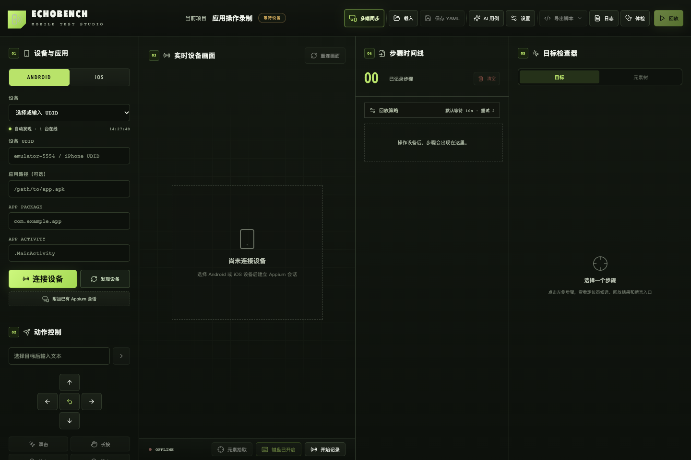
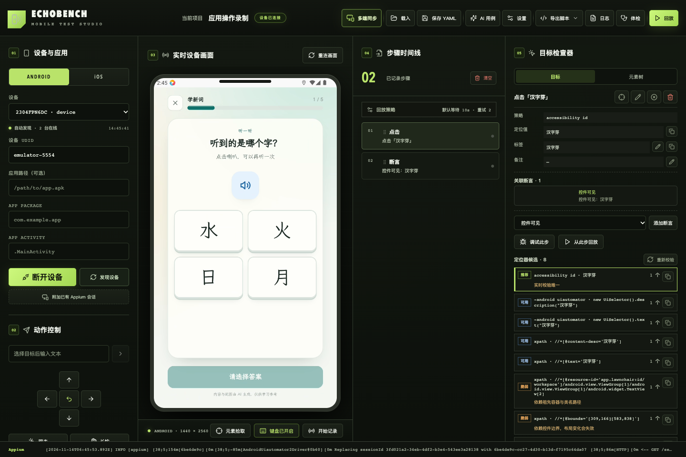
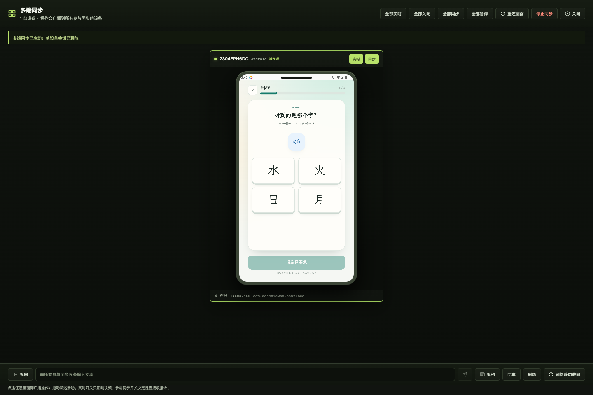
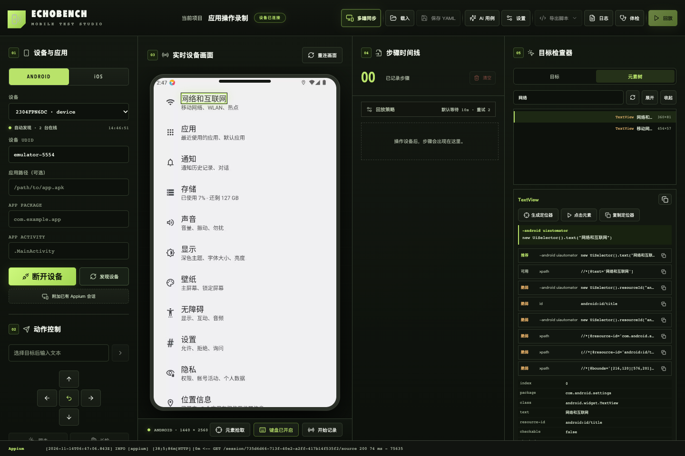
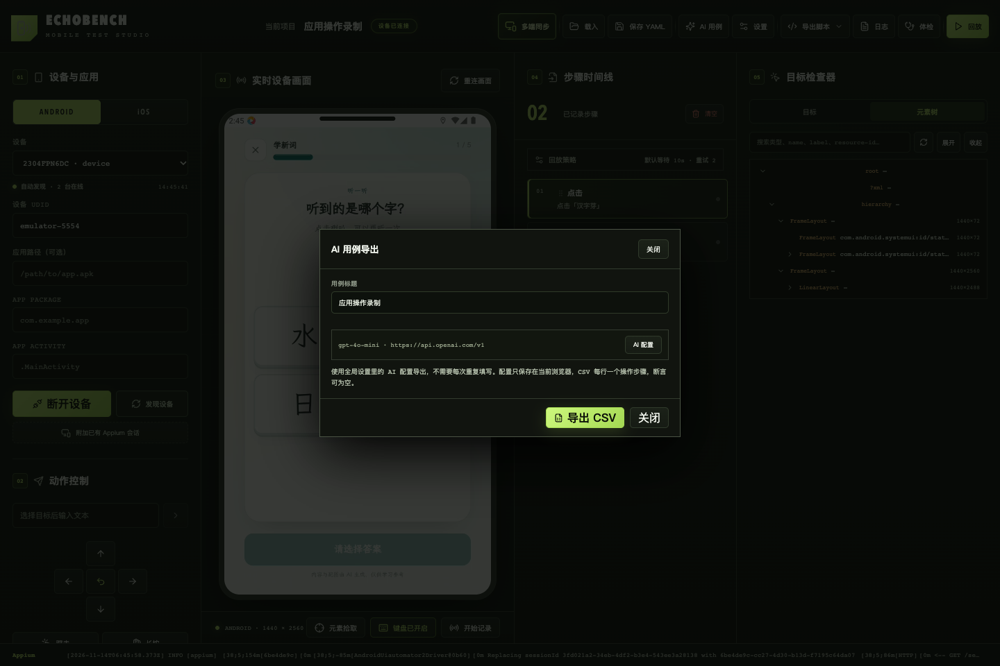

# EchoBench 使用手册

[English](en/user-guide.md) | 简体中文

> 适用版本：EchoBench 1.0.0
>
> 适用对象：第一次使用 EchoBench 的测试人员、产品人员、开发人员
>
> 文档范围：只讲成品怎么用，包括首次启动后的环境体检和依赖补齐；不包含 EchoBench 本身的安装、部署、源码构建和命令行安装步骤

EchoBench 是一个在本机操作的移动端测试工作台。你可以把它理解成三样东西的组合：

1. **设备遥控器**：在电脑上看到手机画面，并直接点击、输入、滑动。
2. **操作录像机**：把你在手机上的动作记录成一条条步骤。
3. **自动回放器**：让工具按照步骤重新操作手机，并检查页面是否符合预期。

这本手册从“产品已经打开”开始。照着做，你可以完成一条完整流程：连接设备、录制、添加断言、回放、保存 YAML、导出 CSV 或脚本。

---

## 目录

- [先看这三件事](#先看这三件事)
- [认识主界面](#认识主界面)
- [第一次打开：体检环境和补齐依赖](#第一次打开体检环境和补齐依赖)
- [第一次使用：10 分钟完成一条流程](#第一次使用10-分钟完成一条流程)
- [常用动作怎么操作](#常用动作怎么操作)
- [看懂定位器和“定位风险”](#看懂定位器和定位风险)
- [添加断言](#添加断言)
- [回放和调试](#回放和调试)
- [保存、载入和导出](#保存载入和导出)
- [多端同步](#多端同步)
- [元素树和附加已有会话](#元素树和附加已有会话)
- [AI 用例导出](#ai-用例导出)
- [草稿、删除和清空](#草稿删除和清空)
- [日志和体检](#日志和体检)
- [安全注意事项](#安全注意事项)
- [常见问题速查](#常见问题速查)
- [新手推荐操作规范](#新手推荐操作规范)
- [术语表](#术语表)

---

## 先看这三件事

### 1. “没有录制”不等于“只读”

关闭录制时，你点击设备画面仍然会操作手机，只是不会新增步骤。

如果只想查看控件、不操作手机，请打开底部的 **元素拾取**。这时点击画面只会读取定位信息，不会点手机。

### 2. 录制前先手动走一遍流程

建议先关闭录制，手动确认：

- 应用能正常打开；
- 页面已经加载完成；
- 要点击的按钮、输入框都能看到；
- 登录账号、测试数据已经准备好。

确认流程没问题后，再回到起始页面开始录制。

### 3. 录制完成后一定要回放

步骤出现在时间线里，不代表它一定能稳定执行。正确做法是：

1. 停止记录；
2. 把设备恢复到流程开始前的页面；
3. 点击顶部 **回放**；
4. 确认每一步都通过；
5. 再保存 YAML 或导出其他格式。

---

## 认识主界面



主界面分为顶部工具栏和五个区域。第一次使用不需要记住全部按钮，先认识下面这些即可。

### 顶部工具栏

| 位置 | 按钮 | 用途 |
| --- | --- | --- |
| 左侧 | EchoBench 标志 | 产品标志 |
| 中间 | 当前项目、设备状态 | 显示当前项目名；绿色“设备已连接”表示设备会话正常 |
| 右侧 | **多端同步** | 进入多设备同步操作模式 |
| 右侧 | **载入** | 选择并载入已有 YAML 脚本 |
| 右侧 | **保存 YAML** | 把当前步骤保存为 `app-steps.yaml` |
| 右侧 | **AI 用例** | 使用 AI 把步骤整理成 CSV 测试用例 |
| 右侧 | **设置** | 配置 AI 接口地址、密钥和模型 |
| 右侧 | **导出脚本** | 导出 WebdriverIO JavaScript、Python 或 Java 脚本 |
| 右侧 | **日志** | 查看最近的运行日志和错误信息 |
| 右侧 | **体检** | 检查当前电脑上的运行环境 |
| 最右侧 | **回放** | 从第一步开始执行当前步骤 |

按钮是灰色时，通常表示当前条件不满足。例如：

- 没连接设备时不能回放；
- 没有步骤时不能保存 YAML；
- 当前系统不支持 iOS 时，iOS 按钮不可用。

### 工作区五个区域

| 区域 | 名称 | 你可以在这里做什么 |
| --- | --- | --- |
| 01 | **设备与应用** | 选择 Android/iOS、选择设备、连接设备、附加已有会话 |
| 02 | **动作控制** | 手动输入文本、执行方向滑动、返回、双击、长按、缩放、元素拾取 |
| 03 | **实时设备画面** | 查看手机画面，直接点击、拖动、输入；底部控制录制和键盘 |
| 04 | **步骤时间线** | 查看录制步骤、调整顺序、设置回放策略、查看回放结果 |
| 05 | **目标检查器** | 查看定位器候选、编辑标签和备注、添加断言、调试单步、浏览元素树 |

区域之间的竖线可以拖动调整宽度。双击竖线可以恢复默认宽度。

### 设备画面底部三个按钮

- **元素拾取**：点击画面只读取元素信息，不操作设备。
- **键盘输入**：开启后，可以直接用电脑键盘向设备的输入框打字。
- **开始记录 / 停止记录**：控制是否把当前操作写入步骤时间线。

---

## 第一次打开：体检环境和补齐依赖

安装完成不等于马上可以连接设备。第一次打开 EchoBench 后，先完成一次环境体检，确认运行环境完整。

### 自动体检

启动页面约 0.6 秒后会自动检查一次，不需要先连接设备。

如果发现缺少必需项，**环境体检** 窗口会自动打开。没有自动打开时，点击顶部 **体检** 手动检查。

### 看懂检查结果

体检会检查运行 EchoBench 所需的各项环境，包括：

- Node.js 版本；
- Appium 和 UiAutomator2；
- macOS 上的 XCUITest；
- Android SDK、`adb`、`scrcpy` 和配套的 `scrcpy-server`；
- JDK / `JAVA_HOME`；
- macOS 上的 Xcode 命令行工具和模拟器状态。

检查结果中：

- 状态正常：不需要处理；
- 标记为 **必需** 且未通过：必须先处理，否则连接设备或回放可能失败；
- 标记为 **可安装**：可以直接使用窗口中的安装入口；
- 警告项：先阅读说明，确认是否会影响当前要使用的平台。

Windows 不检查 Xcode / XCUITest；Linux 只保留 Android 相关检查。这是平台限制，不是安装失败。

### 安装缺失依赖

1. 找到状态未通过、并且带有 **安装** 按钮的项目。
2. 单项缺失时，点击该项右侧的 **安装**。
3. 多项缺失时，点击 **一键安装缺失项**。
4. 等待界面显示安装结果，不要关闭应用或重复点击。
5. 安装完成后，工具会自动刷新检查结果。
6. 如果提示需要重启应用，请关闭并重新打开 EchoBench。
7. 仍然有未通过项时，点击 **重新检查**。

不同系统的安装方式：

| 系统 | 处理方式 |
| --- | --- |
| macOS | 使用 Homebrew 安装 |
| Windows | 使用 winget 安装 |
| Linux | 界面给出对应的 `sudo` 命令，不会静默提权 |

项目内置的 Appium 驱动会在启动后自动补齐，不需要手动执行驱动安装命令。

### 安装依赖后仍有问题

- 点击顶部 **日志**，查看实际错误信息；
- 如果刚安装完包管理器或系统工具，关闭并重新打开 EchoBench，让新的 `PATH` 生效；
- 点击 **重新检查**，确认状态已经更新；
- 完整的环境说明和手动排查方式见[安装与依赖](install.md)。

### 开始使用前确认

- [ ] 当前要使用的平台对应的必需项全部通过；
- [ ] Android 的 `adb`、`scrcpy`、JDK 正常；
- [ ] 使用 iOS 时，Xcode 和 XCUITest 检查正常；
- [ ] 没有“需要重启应用”的提示；
- [ ] 点击“重新检查”后，缺失项没有反复出现。

完成以上检查后，再进入下面的录制流程。

---

## 第一次使用：10 分钟完成一条流程

下面以“登录后进入首页”为例。不同应用的按钮名称会不同，操作顺序相同。

### 第 1 步：选择设备

1. 在左侧 **设备与应用** 区域选择 **ANDROID** 或 **iOS**。
2. 在 **设备** 下拉框中选择目标设备。
3. 如果列表为空，点击 **发现设备**。
4. 只有状态为 `device` 的设备可以连接；`offline`、`unauthorized` 或“未启动”的设备需要先处理。

设备右侧的 **设备 UDID** 会自动填写。你也可以手动输入设备编号。

### 第 2 步：填写应用信息

第一次使用建议保持简单：

- 如果手机上已经打开了要测试的应用，**应用路径、APP PACKAGE、APP ACTIVITY、BUNDLE ID 可以留空**。
- 只有需要工具自动启动指定应用时，才填写包名、Activity 或 Bundle ID。
- 只有需要让工具从本地应用包启动应用时，才填写 **应用路径**。

> 小白建议：先手动打开应用，再连接设备，应用相关信息全部留空。

### 第 3 步：连接设备

1. 点击 **连接设备**。
2. 等待中间出现实时手机画面。
3. 底部状态栏显示类似 `ANDROID · 1080 × 2400`，说明连接成功。

第一次连接通常比后续慢，因为工具需要启动底层自动化服务。

如果画面一直不出来：

- 确认手机已解锁；
- 确认设备仍在线；
- 点击画面右上角的 **重连画面**；
- 查看顶部 **日志**。

### 第 4 步：先不录制，手动试一遍

此时底部应显示 **开始记录**，表示当前没有录制。

在设备画面中手动完成一次登录流程：

1. 点击用户名输入框；
2. 用电脑键盘输入测试账号；
3. 点击密码输入框；
4. 输入测试密码；
5. 点击登录按钮；
6. 确认首页打开。

这一遍只用来确认页面和数据正常，不会生成步骤。

### 第 5 步：回到起始页面并开始录制

1. 把设备退回登录页面。
2. 点击底部 **开始记录**。按钮会变成 **停止记录**。
3. 按照刚才的顺序重新操作一遍。
4. 每次点击、输入、滑动或返回后，**步骤时间线** 会出现一条新步骤。
5. 输入完成后停顿约 0.3 秒，输入内容会合并成一条输入步骤。



### 第 6 步：添加一个结果断言

以“登录后首页出现”为例：

1. 登录成功后，保持设备停留在首页。
2. 点击底部 **元素拾取**，然后点击首页上一个明确的元素，例如首页标题。
3. 在右侧 **目标检查器** 的条件下拉框选择 **控件可见**。
4. 点击 **添加断言**。
5. 时间线中会出现一条“断言：控件可见：…”。
6. 再次点击 **元素拾取**，退出拾取模式。

不要通过选“点击登录”步骤来添加“首页出现”断言，因为那样检查的是登录按钮，不是首页元素。详细规则见[添加断言](#添加断言)。

### 第 7 步：停止录制并回放

1. 点击 **停止记录**。
2. 把设备恢复到登录页面。
3. 点击顶部 **回放**。
4. 观察每一步是否变成“通过”。
5. 如果失败，先看右侧检查器中的 **失败原因**。

### 第 8 步：保存结果

- 点击 **保存 YAML**，浏览器会下载 `app-steps.yaml`。
- 需要给测试管理工具使用时，点击 **AI 用例** 导出 CSV。
- 需要给自动化工程使用时，点击 **导出脚本**。

到这一步，你已经完成了一条可回放的测试流程。

---

## 常用动作怎么操作

### 点击

1. 点击底部 **开始记录**。
2. 在实时设备画面中点击目标位置。
3. 手机执行点击，同时时间线新增一条“点击”步骤。
4. 右侧检查器会显示这次点击使用的定位器和候选方案。

如果点击后没有新增步骤，检查：

- 是否仍处于“开始记录”状态；
- 是否正在回放或执行其他任务；
- 是否开启了 **元素拾取**。元素拾取模式下不会执行点击。

### 输入文字

推荐使用底部 **键盘输入**：

1. 确认底部显示 **键盘已开启**。
2. 在设备画面中点击输入框，让输入框获得焦点。
3. 直接用电脑键盘输入，支持中文输入法。
4. 停顿约 0.3 秒、点击其他位置或执行下一步后，工具会生成一条输入步骤。

注意：

- 必须先点击设备上的输入框。没有聚焦输入框时，画面会提示“当前没有聚焦的输入框”；
- 连续输入到同一个输入框，通常只保留一条输入步骤；
- 切换到另一个输入框后，会生成新的输入步骤；
- 输入内容会明文保存在 YAML 和导出文件中，不要录制真实密码、令牌或个人信息。

左侧 **动作控制** 中的“选择目标后输入文本”是另一种方式，适合已经选中了一个带定位器的点击步骤后，再向该目标输入文本。新手优先使用键盘输入即可。

### 滑动

有两种方式：

**方式一：直接在画面上拖动**

1. 在设备画面按住并拖动。
2. 工具会按实际起点、终点和拖动时长执行滑动。
3. 录制开启时，会生成一条带实际轨迹的滑动步骤。

**方式二：使用左侧方向键**

- 上、下、左、右箭头会执行默认方向滑动；
- 中间弯曲箭头执行“返回”；
- 录制开启时，方向键滑动会记录默认轨迹的起止坐标和距离。

### 返回

点击左侧方向键中间的返回按钮。录制开启时，会生成一条“返回上一页”步骤。

### 双击、长按、放大、缩小

这四个动作要求先在时间线中选中一个步骤：

1. 选中带有目标控件的步骤，例如“点击用户名”。
2. 点击左侧的 **双击**、**长按**、**放大** 或 **缩小**。
3. 录制开启时，新动作会追加到步骤末尾。

- 双击和长按使用当前选中步骤的目标控件；
- 放大和缩小优先使用当前目标；没有目标时作用于屏幕中心；
- 长按默认持续 800 毫秒；
- 放大和缩小的默认持续时间为 600 毫秒。

### 元素拾取

元素拾取适合“我只想知道这个位置是什么元素，暂时不要点手机”的场景。

1. 点击底部 **元素拾取**。
2. 点击设备画面中的目标。
3. 画面只会读取控件和定位信息，不会操作手机。
4. 右侧显示拾取结果。
5. 你可以：
   - 修改标签；
   - 添加为点击步骤；
   - 添加断言；
   - 查看和切换定位器候选；
   - 重新校验定位器。

如果拾取结果提示“仅坐标”，说明这个位置没有可用的原生控件信息。可以修改标签后添加为坐标点击步骤，或者考虑使用“页面稳定”断言。

### 调整步骤

- 拖动时间线中的步骤可以调整顺序；
- 选中步骤后，右侧检查器的垃圾桶按钮可以删除该步骤；
- 可以编辑步骤标签、备注和输入值；
- 选中步骤后，右侧会显示关联断言、定位器候选和回放结果。

### 刷新控件树

当页面已经切换，但工具仍识别到旧页面元素时：

1. 点击左侧 **刷新控件树**；
2. 等待读取完成；
3. 重新点击或使用元素拾取。

iOS 页面变化后如果定位不准，可以先使用这个按钮。

---

## 看懂定位器和“定位风险”

### 什么是定位器

定位器可以理解成“工具查找控件的地址”。

例如，工具不只会记住“屏幕中间偏下有一个按钮”，还会尝试记住：

- 这个按钮的文本；
- 这个按钮的资源编号；
- 这个按钮的无障碍名称；
- 这个按钮在控件树中的位置。

这样回放时，即使手机尺寸或页面布局稍微变化，工具仍有机会找到正确控件。

### 三种候选

选中一个步骤后，右侧 **定位器候选** 会显示多种方案：

| 标记 | 含义 | 建议 |
| --- | --- | --- |
| **推荐** | 命中 1 个元素，策略较稳定，位置也经过校验 | 优先使用 |
| **可用** | 命中 1 个元素，可以作为备用方案 | 推荐项失效时可以切换 |
| **脆弱** | 依赖序号、坐标范围或较弱的层级关系 | 一般不要作为主方案 |

候选右侧显示“1 个”，表示只命中一个元素；“多个”表示可能匹配到多个控件。

### 定位风险是什么意思

如果时间线出现 **定位风险**，说明录制时工具没有找到一个足够可靠的定位器。

常见原因：

- 页面正在切换，控件还没稳定；
- 点击到了背景图、整屏容器或自定义绘制区域；
- 图标没有文字、编号或无障碍信息；
- 同一个页面有多个长得一样的控件。

处理顺序：

1. 等页面稳定后重新点击录制；
2. 选中步骤，点击右侧 **重新校验**；
3. 在候选列表中切换一个“推荐”或“可用”方案；
4. 仍然不行时，使用 **元素拾取**；
5. 如果控件本身没有语义信息，只能使用坐标点击。此时不要默认打开“坐标兜底”。

### 编辑定位器

选中步骤后，点击右侧的铅笔按钮可以修改定位策略和定位值。

修改后建议立即：

1. 点击 **重新校验**；
2. 点击 **调试此步**；
3. 确认工具确实能命中目标控件。

不要为了让一步通过而随意改成非常宽泛的定位值，否则可能点错其他控件。

---

## 添加断言

断言是“检查页面应该出现什么结果”。没有断言的流程只能证明动作执行了，不能证明业务结果正确。

### 推荐的断言位置

- 登录后：首页或用户名出现；
- 搜索后：搜索结果列表出现；
- 提交表单后：成功提示出现，或错误提示不出现；
- 页面切换后：页面稳定；
- 删除后：目标内容隐藏或列表为空；
- 输入后：输入框文本符合预期。

### 可用条件

在右侧检查器中选择条件：

| 条件 | 用途 |
| --- | --- |
| **控件出现** | 页面上存在这个控件 |
| **控件可见** | 控件存在并且用户能看到 |
| **控件隐藏** | 控件不应显示 |
| **控件可用** | 控件处于可操作状态 |
| **控件禁用** | 控件处于不可操作状态 |
| **控件已选中** | 复选框、单选框或开关已选中 |
| **控件未选中** | 复选框、单选框或开关未选中 |
| **控件内容为空** | 输入框或文本控件内容为空 |
| **控件文本匹配** | 控件文字符合预期 |
| **页面稳定** | 页面停止变化，不需要指定控件 |

### 添加控件断言

1. 选中一个带目标的步骤，或先用 **元素拾取** 选中目标；
2. 在右侧选择断言条件；
3. 如果选择“控件文本匹配”，填写期望文本；
4. 选择匹配方式：
   - **包含**：文字中包含期望内容；
   - **等于**：文字必须完全一致；
   - **正则**：使用正则表达式匹配；
5. 点击 **添加断言**；
6. 选中刚生成的断言，可以在右侧单独修改它的超时时间。

断言会作为一条独立的 `wait` 步骤显示在时间线中。

> 断言检查的是“当前选中的步骤目标”或“最近一次元素拾取的目标”。如果要检查新页面上的元素，请先用元素拾取选中它，不要直接沿用上一步的点击目标。

### 添加页面稳定断言

页面切换后不知道等哪个控件时，可以使用“页面稳定”：

1. 不选择目标也可以；
2. 条件选择 **页面稳定**；
3. 点击 **添加断言**。

它适合放在页面跳转后，但不应该代替业务结果断言。比如“登录成功”最好同时检查首页元素，而不只是等待页面稳定。

### 修改断言

选中一条断言步骤后，可以在右侧修改：

- 断言条件；
- 期望文本；
- 匹配方式；
- 超时时间。

修改后重新回放，确认断言不是误判。

### 断言失败的常见原因

- 页面还没加载到目标状态，超时太短；
- 定位器命中了错误控件；
- 期望文本和页面实际文本不完全一致；
- 应用使用了 WebView、Canvas 或自绘控件，原生控件树读不到内容；
- 回放开始前，设备没有处于正确的页面状态。

---

## 回放和调试

### 从头回放

1. 确认设备连接正常；
2. 把设备恢复到第一步执行前的页面；
3. 点击顶部 **回放**；
4. 观察中间设备画面和右侧步骤状态。

回放时，工具会暂时停止录制；回放结束后恢复录制按钮之前的状态。

### 从中间某一步回放

1. 在时间线中选中要开始的步骤；
2. 在右侧点击 **从此步回放**；
3. 前面的步骤会显示为“未执行”，进度只计算实际执行的步骤。

注意：工具不会自动把设备恢复到这一步之前的页面。你必须先手动把设备操作到正确状态。

### 只调试当前步骤

1. 选中一个步骤；
2. 点击右侧 **调试此步**；
3. 工具只执行这一条步骤，不执行前后步骤；
4. 右侧显示通过、失败、耗时和失败原因。

适合在修改定位器或断言后快速验证。

### 看懂回放状态

回放过程中可能看到：

- **等待控件就绪**：工具正在等待目标元素出现；
- **等待页面稳定**：上一次操作后页面还在变化；
- **重试 2/3**：这一步正在重试；
- **通过**：步骤执行成功；
- **失败**：步骤未达到预期；
- **未执行**：从中间回放时被跳过的步骤。

右侧检查器还会显示耗时、重试次数、等待时间和失败原因。

### 回放策略怎么设

展开时间线上方的 **回放策略**：

| 设置 | 默认建议 | 说明 |
| --- | --- | --- |
| **单步等待上限（秒）** | 10 秒 | 页面较慢时可以改为 20～30 秒 |
| **动作重试次数** | 2 次 | 主要用于输入和校验等可安全重试的动作 |
| **重试间隔（毫秒）** | 500 毫秒 | 一般保持默认 |
| **页面稳定等待** | 开启 | 操作前等待页面停止变化，减少误点 |
| **坐标兜底** | 关闭 | 找不到定位器时不按记录坐标乱点，避免点错页面 |
| **候选降级** | 开启 | 主定位失效时尝试其他已验证的唯一候选 |
| **校验前台应用** | 开启 | 回放前检查目标应用是否在前台 |
| **失败即停** | 开启 | 某一步失败后停止，避免后续动作继续污染页面 |

> 新手建议：先保持默认设置，不要为了方便随便打开“坐标兜底”。

### 回放失败怎么办

按这个顺序排查：

1. **页面是否在正确状态**：回放不会自动补齐前置步骤；
2. **步骤是否显示定位风险**：有风险就先处理定位器；
3. **应用是否在前台**：切到其他应用时会触发前台应用校验失败；
4. **等待时间是否太短**：慢页面可以提高到 20～30 秒；
5. **定位器候选是否过期**：点击“重新校验”，必要时重新拾取；
6. **是否使用了动态内容**：列表序号、时间、随机文案会降低定位稳定性；
7. **是否碰上系统弹窗、通知栏或权限弹窗**：这些场景需要单独处理；
8. **查看日志**：顶部 **日志** 会显示底层错误原因。

---

## 保存、载入和导出

### 自动草稿

步骤、设备配置和回放策略会自动保存在当前浏览器本地。

- 刷新页面后，步骤会恢复；
- 页面会提示恢复时间；
- 设备连接不会恢复，需要重新连接；
- 更换浏览器、使用无痕窗口或清理浏览器数据后，草稿会消失。

重要流程不要只依赖自动草稿，完成阶段后请保存 YAML。

### 保存 YAML

点击顶部 **保存 YAML**，会下载：

```text
app-steps.yaml
```

YAML 包含：

- 项目名；
- 平台；
- 设备能力和应用配置；
- 回放策略；
- 全部步骤、断言和定位器。

### 载入 YAML

1. 点击顶部 **载入**；
2. 选择已有的 `.yaml` 文件；
3. 工具会校验文件结构并载入步骤；
4. 确认设备配置是否与当前设备一致；
5. 重新连接设备后回放。

载入后，设备 UDID、包名、Bundle ID 等配置可能来自旧环境，回放前必须检查。

### 导出测试脚本

点击顶部 **导出脚本**，可以选择：

| 格式 | 下载文件 | 适合谁 |
| --- | --- | --- |
| **WebdriverIO JS** | `app-steps.js` | 已有 Node/WebdriverIO 工程 |
| **Python (Appium)** | `app-steps.py` | 已有 Python/Appium 工程 |
| **Java (Appium)** | `AppSteps.java` | 已有 Maven/Gradle/Appium 工程 |

这三种文件是给自动化工程继续使用的，不是普通测试人员必须导出的格式。

导出前请检查：

- 设备 UDID 是否与目标环境一致；
- 包名、Bundle ID 是否正确；
- 输入内容是否包含敏感信息；
- 定位器是否包含临时页面数据。

> 导出的代码文件和 YAML 都会明文保存输入内容。`secret: true` 只是跳过输入文本校验，不会隐藏或加密内容。

---

## 多端同步



多端同步适合“同一个操作要在多台设备上一起执行”的场景。

### 启动多端同步

1. 点击顶部 **多端同步**；
2. 在设备列表中勾选一台或多台在线设备；
3. 如有 iOS 设备，可以填写 **iOS BUNDLE ID**，用于激活前台应用；
4. 点击 **开始多端同步**；
5. 等待每台设备显示实时画面。

启动后，单设备工作区的会话会被释放，避免同一设备或底层端口冲突。

已选设备进入同步页后，默认参与同步并开启实时画面，之后可以逐台关闭。

### 实时和同步的区别

每台设备有两个独立开关：

- **实时**：只控制这台设备是否显示实时画面；
- **同步**：控制这台设备是否接收广播操作。

可以只开实时不同步，也可以只同步不实时。不同步的设备不会执行你发出的点击和输入。

### 怎么操作

- 点击任意设备画面，操作会广播给所有“同步开启且在线”的设备；
- 在画面上拖动可以发送滑动；
- 底部可以统一发送返回、文本、退格、回车和删除；
- 非实时设备可以手动刷新截图；
- 顶部可以一键全部实时、全部关闭、全部同步、全部暂停。

### 多端同步不做什么

- 不录制步骤；
- 不生成断言；
- 不保存 YAML；
- 不是帧级同步；
- 不在运行中动态增加或删除设备；
- 不保证不同系统、不同布局上的同一相对坐标一定落到同一个控件。

### 使用建议

- 优先使用同平台、同方向、同一应用的设备；
- Android 与 iOS 混合时，开始前会要求确认风险；
- Android 的批量文本输入不支持直接输入中文等非 ASCII 内容，这类设备会单独报错，其他设备继续执行；
- 超过 2 路实时画面会明显增加电脑 CPU 占用；
- 单次最多支持 8 台设备；
- 多端同步结束后，如果要继续录制，需要停止同步并重新连接单设备。

---

## 元素树和附加已有会话

这两项属于进阶功能。普通录制不要求掌握，但遇到“点得到、定位不到”或“已有 Appium 会话”时很有用。

### 元素树



连接设备后，在右侧 **目标检查器** 顶部切换到 **元素树**：

1. 顶部搜索框可以搜索类型、name、label、resource-id；
2. 点击展开/收起控件层级；
3. 点击某个节点，设备画面会高亮对应区域；
4. 右侧显示完整属性、bounds（控件位置和尺寸）以及层级路径；
5. 点击 **生成定位器**，查看该节点对应的推荐、可用和脆弱候选；
6. 点击 **点击元素** 可以直接操作该节点，但这个动作不会自动写入步骤时间线；
7. 复制定位器后，可以粘贴到其他步骤或自动化工程中。

元素树当前主要覆盖原生控件。WebView 内的 HTML 元素、Canvas 绘制内容和部分游戏界面可能无法浏览。

### 附加已有 Appium 会话

如果你或另一个测试脚本已经创建了 Appium 会话，可以点击左侧 **附加已有 Appium 会话**，填写：

- **Appium Server URL**，例如 `http://127.0.0.1:4723`；
- **Session ID**；
- 平台；
- 可选的设备 UDID；
- iOS 可选的 WDA MJPEG 端口。

附加模式不会创建新会话，也不会在脱离时结束外部会话。

需要注意：

- Session ID 不是设备编号，而是 Appium 会话的运行时 ID；
- Session ID 过期、Appium 重启或创建会话的程序关闭后，附加会失败；
- 不提供视频信息时，工具会使用静态截图模式；点击、输入、回放和定位器校验仍然可用，但画面需要手动刷新；
- 不知道 Session ID 时，不要使用这个功能，直接连接设备即可；
- Session ID 等同于设备控制权，不要分享给无关人员。

---

## AI 用例导出



AI 用例导出会把当前步骤整理成一份 CSV 测试用例。它不会操作设备，也不会自动修复步骤。

### 第一次配置

1. 点击顶部 **设置**；
2. 找到 **AI 用例** 区域；
3. 填写 **Base URL**；
4. 填写 **API Key**；
5. 填写 **Model**；
6. 点击 **测试连接**；
7. 看到连接成功后，点击 **保存配置**。

常见填写方式：

- Base URL 通常填写到 `/v1`，例如 `https://api.openai.com/v1`；
- 也可以直接填写完整的 `/chat/completions` 地址；
- 支持 OpenAI 兼容接口；
- 本地模型服务如果没有鉴权，API Key 可以留空；
- 配置只保存在当前浏览器，不会写入服务端文件。

### 导出 CSV

1. 确认时间线中已经有步骤；
2. 点击顶部 **AI 用例**；
3. 填写本次用例标题；
4. 点击 **导出 CSV**；
5. 下载文件名为“用例标题-测试用例.csv”。

CSV 包含四列：

```text
用例标题, 序号, 操作步骤, 断言
```

- 每一行对应一个可执行操作；
- 断言可以为空；
- 同一操作后的多个断言会合并在同一格；
- 密码和 `secret` 输入的敏感值在 AI 请求中会脱敏为 `******`；
- 单次最多导出 500 个操作步骤。

CSV 带 UTF-8 BOM，可以直接用 Excel 打开。

### 配置失败怎么办

- **请填写 AI Base URL**：Base URL 为空；
- **AI Base URL 不是合法地址**：检查是否以 `http://` 或 `https://` 开头；
- **连接失败**：检查网络、模型名、密钥和接口地址；
- **接口返回非 JSON**：服务地址可能不是兼容接口；
- **没有步骤**：先录制或载入 YAML；
- **请填写用例标题**：在 AI 用例窗口中补全标题；
- **换浏览器后配置消失**：配置只保存在当前浏览器，需要重新填写。

---

## 草稿、删除和清空

### 恢复草稿

重新打开或刷新页面后，如果时间线中有步骤，顶部会显示一条“已恢复 … 的缓存记录”提示。

点击 **知道了** 只会关闭提示，不会删除草稿。

### 删除单个步骤

1. 在时间线中选中步骤；
2. 点击右侧检查器顶部的垃圾桶按钮；
3. 该步骤会被删除。

### 清空全部记录

1. 点击步骤时间线右上角的 **清空**；
2. 第一次确认；
3. 再次确认；
4. 当前步骤和本地草稿会被删除；
5. 录制会自动关闭。

清空后无法通过刷新恢复，除非之前保存过 YAML。

### 什么时候应该清空

- 开始一条全新的测试流程；
- 当前录制已经混入大量错误步骤；
- 需要删除本地草稿中的敏感数据；
- 准备从 YAML 重新载入。

---

## 日志和体检

### 日志

点击顶部 **日志**，可以查看最近的运行日志：

- Appium 会话状态；
- 设备连接错误；
- iOS 构建和签名错误；
- 回放失败原因；
- 服务端异常堆栈。

日志支持 **复制全部** 和 **刷新**。提交问题前请先删除设备编号、账号、页面内容和密钥等敏感信息。

### 体检

首次启动时务必先完成[体检环境和补齐依赖](#第一次打开体检环境和补齐依赖)。运行过程中如果换电脑、更新系统工具或出现连接异常，也可以再次点击顶部 **体检**。

体检窗口可以查看当前环境是否满足要求：

- Node、Appium 驱动；
- Android 工具和 scrcpy；
- JDK；
- Xcode 和 iOS 相关组件；
- 当前系统支持哪些平台。

缺失且可安装的项目，可以直接点击 **安装** 或 **一键安装缺失项**。安装完成后工具会自动刷新结果；如果提示需要重启应用，请重新打开 EchoBench 后再检查一次。

EchoBench 本身的安装和手动环境配置见[安装与依赖](install.md)。

---

## 安全注意事项

### 不要暴露本地服务

EchoBench 默认只在本机使用，没有登录鉴权。不要通过反向代理、内网穿透或公网地址把它开放给其他人。

### 不要录制真实敏感信息

以下内容会以明文出现在 YAML、CSV 或导出代码中：

- 密码；
- 令牌；
- 身份证号；
- 手机号；
- 银行卡号；
- 真实用户隐私数据。

请使用测试账号和测试数据。`secret: true` 不会加密输入值，只会跳过输入文本校验。

### 小心 Session ID

Appium 的 Server URL 加 Session ID 基本等同于设备控制权。不要把 Session ID、Appium 地址和完整日志发到公开渠道。

### 共用电脑时清理草稿

草稿保存在当前浏览器的本地存储中。共用电脑、录制了敏感页面或准备交付电脑时，请使用 **清空**，或者清理浏览器站点数据。

### AI 配置

AI 配置保存在当前浏览器。测试连接和导出时，配置会临时经过本地服务调用你指定的 AI 接口，请求结束后不会在服务端保留配置。

不要把公司内部密钥填写到不可信的第三方接口地址。

API Key 同样保存在当前浏览器的本地存储中。共用电脑时，请清理浏览器站点数据。

---

## 常见问题速查

| 现象 | 优先检查 | 处理方法 |
| --- | --- | --- |
| 设备列表为空 | 手机是否解锁、USB 是否连接、模拟器是否启动 | 点击“发现设备”；重新插拔或启动模拟器 |
| 设备显示 offline | 设备是否授权当前电脑、是否处于离线状态 | 解锁、信任电脑、重新连接 |
| 连上了但画面黑屏 | 设备是否亮屏、页面是否禁止截屏 | 解锁并点亮；点击“重连画面”；银行/支付类安全页面无法绕过 |
| 点击手机有反应，但没有步骤 | 录制是否开启 | 点击底部“开始记录” |
| 点击完全没有反应 | 是否开启元素拾取、是否正在回放、是否忙于其他任务 | 关闭元素拾取；等待当前任务结束 |
| 输入没有反应 | 输入框是否获得焦点、键盘输入是否开启 | 点击设备上的输入框；开启“键盘输入” |
| 时间线出现定位风险 | 定位器是否唯一、页面是否稳定 | 等页面稳定重新录制；重新校验；切换推荐候选 |
| 回放第一步就失败 | 设备是否处于第一步执行前的页面 | 手动回到起始页后从头回放 |
| 某一步偶尔失败 | 页面加载速度、动态内容、定位器是否变化 | 提高等待上限；重新校验；改用更稳定文本或元素 |
| 断言一直失败 | 期望文本、超时、控件是否可见 | 查看右侧失败原因；用元素拾取重新选择目标 |
| 刷新页面后设备没了 | 设备会话不会写入草稿 | 重新选择设备并连接，步骤会保留 |
| 两个浏览器页面只有一个有画面 | Android 实时视频只允许一个消费者 | 关闭重复页面后重连画面 |
| 多端操作落点不一致 | 设备尺寸、平台和布局不同 | 优先使用同平台、同方向、同布局设备 |
| AI 用例导出失败 | AI 配置、网络、模型是否可用 | 在设置中测试连接；检查标题和步骤是否为空 |
| 载入 YAML 后回放失败 | YAML 中的 UDID、包名、Bundle ID 是否属于当前环境 | 修改设备配置并重新连接 |

---

## 新手推荐操作规范

照着下面做，能避免大多数“录得出来、回放不稳定”的问题。

1. **一条流程只做一件事**：例如“登录”“搜索商品”“提交订单”分别录制，不要把所有业务混在一个超长流程里。

2. **录制前先手动成功走一遍**：确认测试数据、账号和页面状态都正确。

3. **每次操作后等页面稳定**：不要在页面动画、加载圈或键盘收起过程中连续猛点。

4. **关键结果必须加断言**：不要只录“点击登录”，还要检查“首页可见”或“登录成功文本出现”。

5. **不要默认打开坐标兜底**：坐标兜底可能让工具在错误页面点到错误位置。只有 Canvas、游戏或确实没有控件语义的区域才考虑打开。

6. **定位风险必须处理**：有风险标记的步骤即使当场能执行，换设备或页面变化后也容易失败。

7. **先调试单步，再回放整条流程**：修改定位器或断言后，先点“调试此步”，通过后再从头回放。

8. **阶段完成后保存 YAML**：自动草稿只存在当前浏览器，清理浏览器数据后会消失。

9. **回放前从干净状态开始**：关闭弹窗、回到起始页面、确认应用在前台，再点击“回放”。

10. **不要录制真实密码和个人信息**：使用测试账号；确需输入敏感值时，提前确认 YAML、CSV、导出脚本和日志的保存范围。

---

## 一页版检查清单

开始录制前：

- [ ] 手机已解锁并保持连接；
- [ ] 应用已打开，页面已加载完成；
- [ ] 测试账号和测试数据可用；
- [ ] 当前页面就是流程起点；
- [ ] 没有开启元素拾取模式。

录制时：

- [ ] 底部已显示“停止记录”，说明正在录制；
- [ ] 每次操作后时间线都新增了步骤；
- [ ] 输入内容正确，没有出现重复输入步骤；
- [ ] 关键页面切换后添加了断言；
- [ ] 发现“定位风险”及时处理。

回放前：

- [ ] 已停止记录；
- [ ] 设备已回到流程起点；
- [ ] 目标应用在前台；
- [ ] 回放策略保持合理；
- [ ] 已保存 YAML。

回放后：

- [ ] 每一步都通过；
- [ ] 断言没有误判；
- [ ] 失败原因已记录并处理；
- [ ] 需要时重新保存 YAML；
- [ ] 需要时导出 CSV 或自动化脚本。

---

## 术语表

| 术语 | 小白解释 |
| --- | --- |
| **设备画面** | 电脑中显示的手机实时界面 |
| **设备 UDID** | 设备的唯一编号，用于区分不同真机或模拟器 |
| **会话** | 工具和手机之间的一次连接。断开、刷新页面或重启服务后通常需要重新建立 |
| **录制** | 把你在设备画面上的操作保存成步骤 |
| **步骤时间线** | 按顺序显示所有已记录动作的区域 |
| **回放** | 让工具按照时间线重新操作手机 |
| **断言** | 检查页面是否达到某个结果 |
| **定位器** | 工具查找控件时使用的“地址” |
| **候选** | 同一个控件可用的多种定位方案 |
| **定位风险** | 当前没有找到足够可靠的定位器 |
| **YAML** | EchoBench 保存流程的可读文本文件 |
| **草稿** | 自动保存在当前浏览器中的临时记录 |
| **多端同步** | 在一台设备上操作，让多台设备一起执行 |
| **元素树** | 当前页面所有原生控件的层级列表 |
| **Appium** | EchoBench 内部连接和控制设备所使用的底层自动化服务，普通使用时不需要直接操作 |
| **Session ID** | Appium 会话的运行时编号，不是手机编号 |
| **CSV 用例** | 可以用 Excel 打开的表格化测试用例 |

---

## 最后建议

第一次使用时，不要急着导出脚本。先完成下面这条闭环：

```text
连接设备 → 手动探索 → 录制 3～5 步 → 添加 1 条断言
→ 调试单步 → 从头回放 → 保存 YAML
```

这条闭环稳定后，再尝试多端同步、元素树、附加会话和 AI 用例导出。

如果某一步失败，不要反复点击碰运气。先确认页面状态，再检查定位器和等待时间，最后查看日志。这样排查最快，也最不容易把错误步骤继续录进流程。
